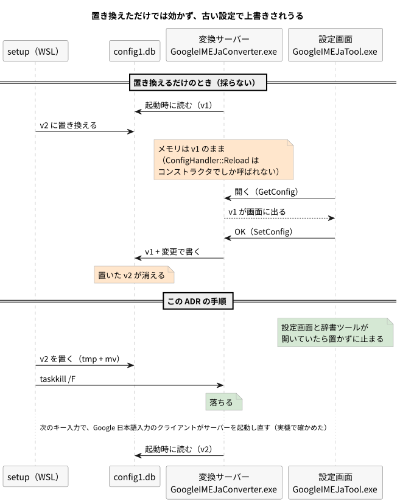
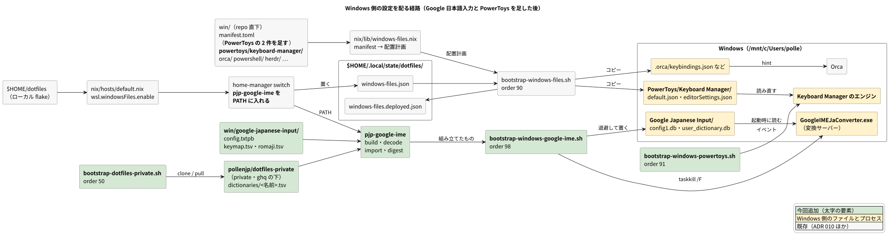
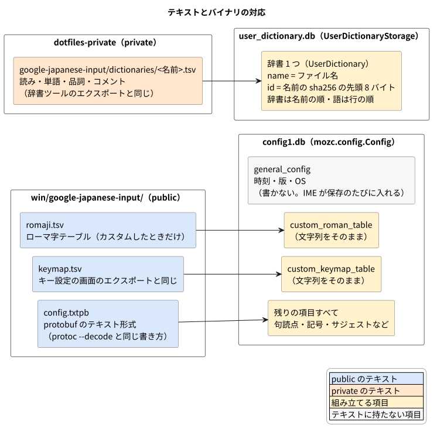
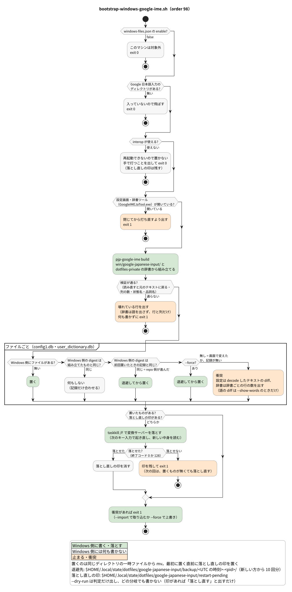
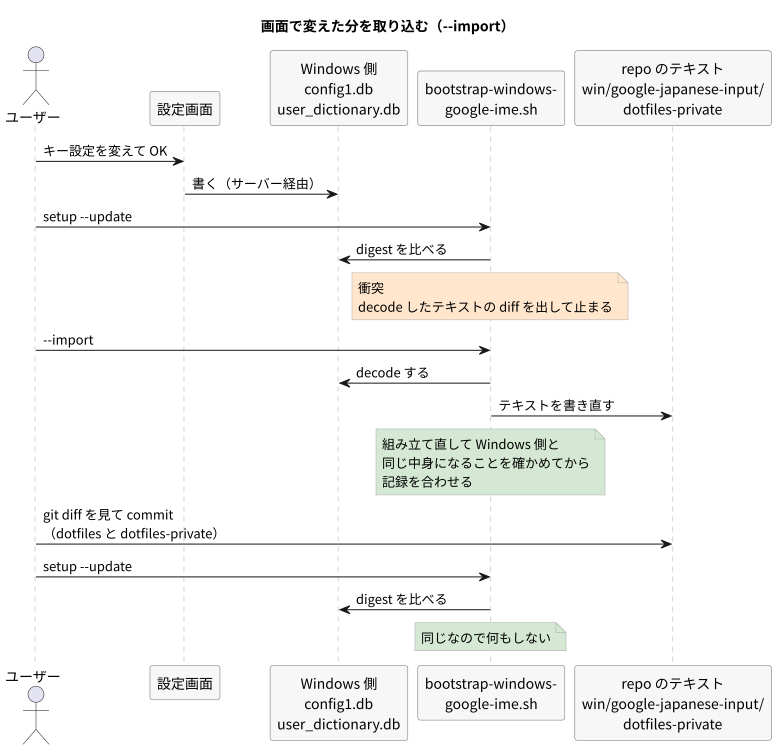
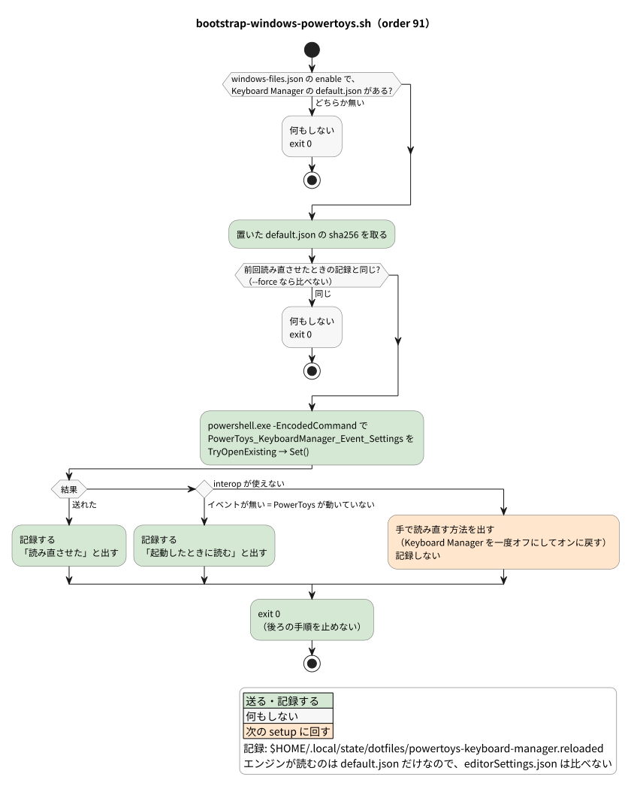

# ADR: Windows 側の Google 日本語入力と PowerToys の設定を、repo のテキストから組み立て直して配る

| 項目 | 内容 |
| --- | --- |
| ステータス | 提案 (Proposed) — レビュー中 |
| 日付 | 2026-10-11 (JST) |
| 決定者 | pollenjp |
| チケット | [TKT-139](https://app.notion.com/p/Windows-Google-dotfiles-win-3f679149a66f81b1a592d85d7300a62b) |
| 前提 ADR | [010_win_files_from_wsl](../010_win_files_from_wsl_20260928T003933JST/README.md)（`win/` を WSL の bootstrap が `/mnt/c` へコピーして配る。衝突したら止める）、[006_nix_closure_sbom_osv_scan](../006_nix_closure_sbom_osv_scan_20260823T004634JST/README.md)（home の閉包をスキャンする） |
| 運用手順 | [`win/README.md`「Google 日本語入力」「PowerToys」](../../../win/README.md)、[`nix/README.md`「bootstrap の実行順」](../../../nix/README.md#bootstrap-の実行順) |

---

## 1. 背景 (Context)

### やりたかったこと

Windows 側の Google 日本語入力の設定を dotfiles で管理したい。この PC ではキー設定を
カスタムしており、F13 で IME をオン / オフする行を足している。F13 は PowerToys の
Keyboard Manager で CapsLock から割り当てている (左 Shift + 英数キーは CapsLock に戻す)。
ユーザー辞書は、Google 日本語入力の辞書ツールの import / export で手で持ち回っている。

ユーザーの希望は、**バイナリそのものを repo で持つことより、repo のテキストから安全に
組み立て直せること**だった。

### 範囲 (TKT-139 で決めた)

| 入れる | 入れない |
| --- | --- |
| Google 日本語入力のプロパティの設定全部 (キー設定・ローマ字テーブル・句読点・サジェストなど) | 学習データ (`history.db`・`segment.db`・`boundary.db`・`cform.db`) |
| ユーザー辞書 | Google 日本語入力と PowerToys を winget で入れること |
| PowerToys の Keyboard Manager の割り当て (`default.json`・`editorSettings.json`) | Keyboard Manager 以外の PowerToys の設定 |

- 辞書の中身は公開したくないので、public のこの repo には置かず、新しく作る private repo
  `pollenjp/dotfiles-private` に置く
- PowerToys も入れるのは、IME のキー設定の F13 が CapsLock → F13 の割り当てを前提にして
  いて、新しいマシンでは両方がそろわないと効かないため

### 設計を縛る事実

この PC の版は Google 日本語入力 2.29.5370.0、PowerToys v0.100.2。Mozc のソースは
`google/mozc` の `18e76511af9371a9a4409b1d13c3e30884b53e9c` (2026-10-09) を読んだ。

#### 1. 設定は protobuf のバイナリで、暗号化はされていない

設定の実体は `%USERPROFILE%\AppData\LocalLow\Google\Google Japanese Input\config1.db` で、
Mozc の `mozc.config.Config` (`src/protocol/config.proto`) を直列化しただけのもの。
`protoc --decode` で全項目が読める。

```text
general_config {
  config_version: 1
  last_modified_product_version: "2.29.5370.0"
  last_modified_time: 1782652220
  platform: "Windows.10.0.0.0"
}
verbose_level: 0
incognito_mode: false
check_default: true
presentation_mode: false
preedit_method: ROMAN
session_keymap: CUSTOM
```

- キー設定は、この中の `custom_keymap_table` に TSV の文字列として入っている。その文字列は
  キー設定の画面の「エクスポート」が書き出すものと同じ (`gui/config_dialog/keymap_editor.cc`
  の `Update()` が組み立て、`generic_table_editor.cc` の `Export()` がそのまま書く)

  ```cpp
    *keymap_table = "status\tkey\tcommand\n";
  …
      absl::StrAppend(keymap_table, status, "\t", key, "\t", command, "\n");
  …
    absl::StrAppend(keymap_table, invisible_keymap_table_);
  ```

- ユーザー辞書の `user_dictionary.db` も protobuf (`mozc.user_dictionary.UserDictionaryStorage`)。
  辞書ツールのエクスポートは「読み・単語・品詞・コメント」の TSV になる
  (`dictionary/user_dictionary_storage.cc` の `ExportDictionary()`)

  ```cpp
      ofs << entry.key() << "\t" << entry.value() << "\t"
          << dictionary::UserPos::GetStringPosType(entry.pos()) << "\t"
          << entry.comment() << std::endl;
  ```

#### 2. 変換サーバーは設定を起動時にしか読まず、古い設定で上書きしうる

`config1.db` を読む `ConfigHandler::Reload()` を呼ぶのは、`ConfigHandlerImpl` の
コンストラクタとテストだけだった (`gh search code "ConfigHandler::Reload" --repo google/mozc`)。
IPC の RELOAD (`SessionHandler::Reload()`) も、メモリ上の設定を各セッションへ配り直すだけで
ファイルは読み直さない。

```cpp
  ConfigHandlerImpl()
      :  // <user_profile>/config1.db
        filename_(absl::StrFormat("%s%d.db", kFileNamePrefix, kConfigVersion)),
        default_config_(std::make_shared<Config>(CreateDefaultConfig())) {
    Reload();
  }
```

設定画面 (`GoogleIMEJaTool.exe`) は、サーバーが覚えている設定を `GetConfig` で読み、OK で
`SetConfig` してサーバーに書かせる。ファイルを置き換えても変換サーバー
(`GoogleIMEJaConverter.exe`) を再起動しないと効かず、その間に設定画面で OK を押すと、
置いたファイルが古い設定で上書きされる。



#### 3. 保存のたびに時刻・版・OS が書き込まれる

`SetConfig` は保存のたびに `general_config` へ時刻・版・OS を入れる (`SetMetaData()`)。中身が
同じでもバイト列が変わるので、ADR 010 の仕組み (置き先の sha256 を前回置いた中身の記録と
比べる) に載せると、画面で OK を押しただけで衝突になる。

```cpp
void SetMetaData(Config* config) {
  GeneralConfig* general_config = config->mutable_general_config();
  general_config->set_config_version(kConfigVersion);
  general_config->set_last_modified_time(
      absl::ToUnixSeconds(Clock::GetAbslTime()));
  general_config->set_last_modified_product_version(Version::GetMozcVersion());
  general_config->set_platform(SystemUtil::GetOSVersionString());
}
```

#### 4. キー設定のコマンド名は版によって揺れる

この PC のキー設定は `InputModeHiragana` などの古い名前を使っているが、今の Mozc は新しい
名前 (`CompositionModeHiragana` など) を持ち、古い名前を別名として受け付けている
(`session/keymap.cc` L83-94)。コマンド名を一覧で検証すると、版によって誤検知になる。

```cpp
static constexpr char kLegacyCommandStringInputModeHiragana[] =
    "InputModeHiragana";
```

状態名は 7 つ (`DirectInput` (`Direct`)・`Precomposition`・`Composition`・`Conversion`・
`ZeroQuerySuggestion`・`Suggestion`・`Prediction`) で揺れていない。

直接入力モードの割り当て (F13 → IMEOn など) は、変えたあとに起動したアプリにだけ効く
(キー設定の画面がそう知らせる)。

#### 5. PowerToys は合図を受けたときだけ読み直す

Keyboard Manager のエンジンは、起動したときと、名前付きイベント
`PowerToys_KeyboardManager_Event_Settings` を受けたときに `default.json` を読む
(`KeyboardManagerEngineLibrary/KeyboardManager.cpp`)。イベントは既定のセキュリティの
自動リセットで作られている (`common/utils/EventWaiter.h`)。

```cpp
    // Load the initial settings.
    LoadSettings();
…
    settingsEventWaiter.start(KeyboardManagerConstants::SettingsEventName, changeSettingsCallback);
```

```cpp
        m_waitingEvent = CreateEventW(nullptr, false, false, name.c_str());
```

新しいエディタ (WinUI 3) は、割り当ての一覧を `editorSettings.json` にも別に持っている。
エンジンが読むのは `default.json` だけ。

#### 6. 変換サーバーは落とせば起き直す (実機で確かめた)

`taskkill /IM GoogleIMEJaConverter.exe` (`/F` なし) は、窓を持たないプロセスなので失敗する。

```text
ERROR: The process "GoogleIMEJaConverter.exe" with PID 25752 could not be terminated.
Reason: This process can only be terminated forcefully (with /F option).
```

`/F` で落とすと、次に日本語を入力したときに Google 日本語入力のクライアントがサーバーを
起動し直し、変換も問題なかった (PID 25752 → 55528。20:51:03 に落とし、20:51:36 に起動。
候補ウィンドウの `GoogleIMEJaRenderer.exe` は元のまま)。

#### 7. 読み直して書き戻すと 1 バイトも違わない (実機のファイルで確かめた)

使い捨てのスクリプトで、この PC の `config1.db` と `user_dictionary.db` を Python の protobuf
(固定した nixpkgs の 7.36.1) で読み、`deterministic` で書き戻した。今の Mozc の `.proto` に
無い項目 (unknown fields) は無く、テキスト形式を経由しても元に戻った。

```text
config1.db: bytes=5862 reencode_identical=True unknown_fields=0
  text_roundtrip_identical=True
…
  rebuild_equals_original_without_general_config=True
user_dictionary.db: bytes=407 reencode_identical=True unknown_fields=0
  text_roundtrip_identical=True
```

#### 8. PowerToys は WSL からのイベントで読み直す (実機で確かめた)

WSL から `powershell.exe -EncodedCommand` で `EventWaitHandle.TryOpenExisting` → `Set()` を
打つと、どちらも `True` を返し、Keyboard Manager のログに合図と読み込みの行が続けて出た。

```text
[2026-10-11 23:37:29.651929] [p-39620] [t-30820] [trace] PowerToys_KeyboardManager_Event_Settings event was signaled
[2026-10-11 23:37:29.654099] [p-39620] [t-30820] [trace] SettingsHelper::LoadSettings()
```

## 2. 決定 (Decision)



### A. repo にはテキストだけを置き、Windows 側の形は setup のたびに組み立てる



| ファイル | 置き場所 | 中身 |
| --- | --- | --- |
| `config.txtpb` | `win/google-japanese-input/` | `config1.db` のうち、下の 3 つを除いた全項目。protobuf のテキスト形式 |
| `keymap.tsv` | `win/google-japanese-input/` | `custom_keymap_table` の文字列そのもの (キー設定の画面のエクスポートと同じ)。表が空なら置かない |
| `romaji.tsv` | `win/google-japanese-input/` | `custom_roman_table` の文字列そのもの。ローマ字テーブルをカスタムしたときだけ置く (表が空なら置かない) |
| `<名前>.tsv` | `pollenjp/dotfiles-private` の `google-japanese-input/dictionaries/` | 辞書 1 つ。辞書ツールのエクスポートと同じ「読み・単語・品詞・コメント」 |

- `config.txtpb` は `protoc --decode` と同じ書き方で、日本語は UTF-8 のまま書く。
  `general_config` は書かない (時刻・版・OS は Google 日本語入力が保存のたびに入れる)。
  `custom_keymap_table` か `custom_roman_table` を書いたら止める (TSV の側に置く)
- 空の表は「無い」と同じに扱う。設定画面は、キー設定を一度もカスタムしていなくても
  `custom_keymap_table` を空文字で入れる (Mozc の `gui/config_dialog/config_dialog.cc`)。
  `custom_roman_table` も同じ bytes の表で、Mozc の getter は空と無いを区別しないので、同じに扱う
- TSV の改行は LF にそろえる。キー設定とローマ字テーブルのテキストを画面のエクスポートと
  同じ形にしておくのは、仕組みが壊れても GUI のインポートで手で戻せるようにするため
- 辞書の名前は拡張子を除いたファイル名。辞書の id は乱数ではなく名前の SHA-256 の先頭
  8 バイトから作る。辞書は名前の順に並べ、語はファイルの行の順に入れる
- 語のコメントは、空でも必ず入れる。Windows 側では、辞書ツールの表で編集した語 (`SyncToStorage`)
  は空でもコメントが「ある」で、単語登録ダイアログ (`WordRegisterDialog::SaveEntry`) と辞書ツールの
  インポート (`user_dictionary_importer.cc`) で入れた語は、コメントが空なら「無い」で入っている。
  proto2 はこの 2 つを別のバイト列にするので、比べる digest は両方を同じに扱う (B)
- 検証するのは、組み立てたものを読み直すと元のテキストに戻ること、キー設定の 1 行目の
  見出し・各行が 3 列であること・状態名が 7 つのどれかであること、辞書の品詞が Mozc の
  45 個の名前のどれかであること。**キー設定のコマンド名は確かめない** (§1 の 4)
- 同じテキストからは毎回同じバイト列ができる (§1 の 7)

### B. テキストとバイナリを行き来する CLI `pjp-google-ime` を `nix/pkgs/` に置く

- Python と protobuf (固定した nixpkgs のもの) で書く。Mozc の `config.proto` と
  `user_dictionary_storage.proto` の写しを `nix/pkgs/pjp-google-ime/proto/` に置き
  (BSD-3-Clause。写した commit を書き添える)、ビルドのときに `protoc` で記述子を作って読む
- サブコマンドは 5 つ

  | サブコマンド | すること |
  | --- | --- |
  | `build` | テキストから `config1.db` と `user_dictionary.db` を組み立てて検証する |
  | `decode` | バイナリをテキストに戻す (衝突の diff と、辞書の衝突の行の数に使う) |
  | `import` | Windows 側のバイナリを decode して、テキストを書き直す |
  | `digest` | 比べるための sha256 を出す (`config1.db` は `general_config` を、辞書は辞書の id と並びを外して直列化する。空の表と空のコメントは「無い」と同じに扱う。A) |
  | `check` | テキストの検証だけをする |

- 辞書の TSV のエラーは、ファイル・行・列の数・どの列が悪いかまでを出し、セルの中身 (読み・
  単語・品詞・コメント) は出さない。setup の出力は Claude などのログにも残り、そこから Dev
  Tracker や PR へ写りうるため。列がずれると品詞の列に語が入るので、品詞の値も出さない
- Windows には触らない。Windows に触るのは bootstrap だけ
- `dotfiles.wsl.windowsFiles.enable` のマシンにだけ、home-manager が PATH に入れる
  (`nix/home/modules/windows-files.nix`)
- repo に commit した決定論的なプログラムで、実行時に LLM は使わない

### C. `bootstrap-windows-google-ime.sh` (order 98) が、組み立て・比較・退避・配置・再起動を受け持つ



| Windows 側の中身 (digest) | 前回置いた中身の記録 | すること |
| --- | --- | --- |
| 無い | 問わない | 置く |
| 組み立てたものと同じ | 問わない | 何もしない (記録だけ合わせる) |
| 組み立てたものと違う | Windows 側と同じ | repo の側が進んだので、退避して置く |
| 組み立てたものと違う | 無い・Windows 側と違う | 衝突。設定は decode したテキストの diff を、辞書は辞書ごとの行の数を出して止まる |

- 判定は ADR 010 と同じ形だが、比べるのはバイト列の sha256 ではなく digest (§1 の 3)。
  画面で OK を押しただけで時刻しか変わっていなければ、衝突にならない。空のコメントと
  空の表も「無い」と同じに扱うので、単語登録ダイアログで足した (コメントが空の) 語や、
  カスタムしていないキー設定が空文字で入っていることでは衝突にならない (A)
- 記録は `~/.local/state/dotfiles/google-japanese-input/deployed.json`、退避先は
  `~/.local/state/dotfiles/google-japanese-input/backup/<UTC の時刻>-<pid>/` (新しい方から 10 回分残す)
- 置くのは同じディレクトリの一時ファイルから `mv` する (ADR 010 と同じ)
- 置いたものがあれば、置いたあとで `taskkill /F` で変換サーバーを落とす (§1 の 2・6)。
  置いてから落とすので、次に起きたサーバーは新しい中身を読む
- 落とせなかったとき (taskkill の終了コードが 0 と 128 以外) は exit 1 にし、落とし直しの印
  `~/.local/state/dotfiles/google-japanese-input/restart-pending` を残す。次の回は、置くものが
  無くても (2 ファイルとも「同じ」でも) 印があれば落とし直し、落とせたら印を消す。記録は置いた
  ときに合わせるので、印が無いと次の回は「同じ」で終わり、古い設定を持つ変換サーバーが残る
  - 印は最初に置く直前に置く。置き終わってから書くと、その間に止まったとき (`set -e`) に残らない
  - 印がある回の衝突には「前回は変換サーバーを落とせていない。この差は古い設定が書き戻された
    ものかもしれない (repo 側を残すなら `--force`)」と添える
  - `--dry-run` は「落とし直す」と出すだけで、taskkill も印の削除もしない。`--import` と、
    interop が使えない回 (置かずに exit 0) も印に触らない (次の普段の回が落とす)
- 前提を先に確かめる
  - `windowsFiles.enable` が false・Google 日本語入力が入っていない → 理由を出して exit 0
  - interop が使えない → 置かずに、手で打つことを出して exit 0。変換サーバーを再起動できず、
    置いたものが古い設定で上書きされうるため
  - 設定画面か辞書ツール (`GoogleIMEJaTool.exe`) が開いている → 閉じてから打ち直すよう出して
    exit 1。開いている間に置くと、閉じるときに古い中身で書き戻されうるため
- 辞書の衝突では、語を出さない (setup の出力は Claude などのログにも残り、そこから Dev Tracker
  や PR へ写りうる)。両側を decode した TSV を行の多重集合として比べ、辞書ごとに「Windows 側に
  だけある行 N・repo 側にだけある行 M」「行は同じで、並びだけが違う」「Windows 側 (repo 側) に
  だけある (N 語)」を出す。辞書の名前は TSV のファイル名なので出す。設定の衝突は、public の
  テキストなので diff を出す
- 引数は `--dry-run` (判定だけ)・`--force` (衝突でも repo の中身で置き直す)・`--import`
  (次の D)・`--check` (テキストの検証だけ。CI 用で Windows も state も要らない)・
  `--show-words` (辞書の衝突でも語の diff を出す。自分の端末で `--dry-run` と一緒に打つ)
  - `--import` と `--dry-run` は一緒に使えない (exit 2)。`--import` は repo のテキストを書き直す
  - `--check` は `config.txtpb` が無ければ exit 1 (CI で確かめるテキストが無い)。普段の回は
    飛ばして exit 0
- order 98 にして bootstrap の最後に走らせる。衝突や前提で exit 1 しても、98 より前の
  bootstrap は済んでいる。setup は失敗した手順で止まるので、98 の後ろの exe-exec-trace と
  最後の「残りの手作業」は、直して流し直すまで走らない

### D. 画面で変えた分は `--import` でテキストへ取り込む



- Windows 側の `config1.db` と `user_dictionary.db` を decode して、`win/google-japanese-input/`
  と dotfiles-private のテキストを書き直す。`user_dictionary.db` から消えた辞書は、その TSV も
  消す (git に履歴が残る)。ローマ字テーブルがカスタムされていなければ `romaji.tsv` も消す
  (キー設定も、表が空なら `keymap.tsv` を消す)
- Windows 側に `user_dictionary.db` が無ければ、辞書は取り込まない (TSV に触らない)。
  `pjp-google-ime: <パス> が無いので、辞書は取り込みません (TSV はそのまま)` と出し、設定の
  取り込みは続ける。ファイルが無いのは辞書をまだ作っていないか置き場所が違うかで、辞書を
  全部消したのとは違うため
- dotfiles-private が無いマシンでは、辞書は取り込まずに警告を出し、設定だけを取り込む
  (配るときも辞書を飛ばしているのと揃える)
- 取り込む前に、`win/google-japanese-input/` と dotfiles-private の辞書のディレクトリに
  commit していない変更 (未追跡のファイルも) が無いことを `git status --porcelain` で確かめる。
  あれば、変わったファイル名を出して何も書かずに exit 1。取り込みはテキストを Windows 側の
  中身で置き換えるので、commit していない変更は痕跡なく消え、戻せないため。git が無い・
  checkout でなく確かめられないときも止める
- 衝突の案内には「`--import` は repo のテキストを Windows 側の中身で置き換える (diff の + の行は
  消える)。両方を残すなら、テキストを手で直してから `--force`」と添える。2 台で別々に単語登録
  したときのマージはしない
- 書き直したら組み立て直し、Windows 側と同じ digest になることを確かめてから記録を合わせる
- 今の `.proto` に無い項目がある (新しい版の Google 日本語入力が足した項目)、辞書の名前に
  ファイル名で使えない文字があるなど、テキストで表せない中身があれば何も書かずに止まる
- `--dry-run` とは一緒に使えない (exit 2)。取り込む前の差は、`--import` を付けずに `--dry-run`
  で見る (辞書の語の diff は `--dry-run --show-words`)
- 取り込んだら、dotfiles と dotfiles-private の両方で commit する

### E. 辞書は `pollenjp/dotfiles-private` に置き、`bootstrap-dotfiles-private.sh` (order 50) が取得する

- `git@github.com:pollenjp/dotfiles-private.git` を `$(ghq root)/github.com/pollenjp/dotfiles-private`
  に clone し (ghq が無ければ `~/ghq`)、あれば `pull --ff-only` する
- 取れないマシン (鍵が無い・オフライン) では警告して exit 0 にし、IME の手順は辞書だけを
  飛ばす。claude-skills の取得 (`bootstrap-claude-skills.sh`) と同じ扱い
- IME の手順 (C・D) も、同じ規則で決まる場所 (`$(ghq root)/github.com/pollenjp/dotfiles-private`)
  を見る
- dotfiles-private は、この repo の flake input にも submodule にもしない

### F. PowerToys は `win/manifest.toml` に 2 件足し、`bootstrap-windows-powertoys.sh` (order 91) が読み直させる



- `win/powertoys/keyboard-manager/default.json` と `editorSettings.json` を、PowerToys が
  書いたバイト列のまま置く (末尾に改行を足さない)。置き先は
  `%LOCALAPPDATA%/Microsoft/PowerToys/Keyboard Manager/` の下。配るのは今の
  `bootstrap-windows-files.sh` で、エディタで変えたら Orca と同じく衝突として止まる
- `bootstrap-windows-powertoys.sh` は、置いた `default.json` の sha256 が前回読み直させた
  ときの記録 (`~/.local/state/dotfiles/powertoys-keyboard-manager.reloaded`) と違うときだけ、
  `powershell.exe` から名前付きイベントを送る (§1 の 5・8)。`--force` なら比べない
- 送る PowerShell の文は `powershell.exe -NoProfile -NonInteractive -Command` で渡す。§1 の 8 の
  実機の確認は `-EncodedCommand` で打ったが、実装は `-Command` にした。`-EncodedCommand` は文を
  UTF-16LE の base64 にする必要があり、そのための `iconv` が要らなくなるため (文は固定の 1 行)。
  `-Command` でも同じ文が届き、Keyboard Manager が読み直すことを実機で確かめた
- PowerToys が動いていなければ (イベントが無ければ) 記録だけする。起動したときに読むため
- interop が使えなければ、手で読み直す方法 (Keyboard Manager を一度オフにしてオンに戻す) を
  出して exit 0 にし、記録しないで次の setup に回す
- どの場合も exit 1 にしない。後ろの手順 (95〜98) を止めないため
- hint は、`default.json` は「setup で流したなら、続く bootstrap-windows-powertoys.sh が
  Keyboard Manager に読み直させる。bootstrap-windows-files.sh だけを手で流したなら
  nix/scripts/bootstrap-windows-powertoys.sh も流す」、`editorSettings.json` は「Keyboard Manager
  のエディタを開いていたら、閉じて開き直す」にする

## 3. 変更点の詳細

| ファイル | 変更 |
| --- | --- |
| `win/google-japanese-input/config.txtpb`・`keymap.tsv` | 新規。この PC の今の設定を `--import` で書き出したもの |
| `win/powertoys/keyboard-manager/default.json`・`editorSettings.json` | 新規。この PC の今のファイルをそのまま写したもの |
| `win/manifest.toml` | PowerToys の 2 件を足す |
| `.gitattributes` | 新規。`win/powertoys/**` の改行を変えない (`-text`) |
| `.editorconfig` | `win/powertoys/**.json` は末尾に改行を足さない、`editorSettings.json` は CRLF |
| `win/README.md` | 「Google 日本語入力」「PowerToys」の節。「衝突したら」の setup の止まり方を事実に合わせる (後ろの手順は走らない) |
| `nix/pkgs/pjp-google-ime/` | 新規。`default.nix`・`google_ime.py`・`test_google_ime.py`・`proto/` (Mozc の `.proto` の写しと LICENSE) |
| `nix/home/modules/windows-files.nix` | `windowsFiles.enable` のとき `pjp-google-ime` を `home.packages` に入れる |
| `nix/home/options.nix` | `windowsFiles.enable` の説明に、`pjp-google-ime` を PATH に入れることと `bootstrap-windows-google-ime.sh` を足す |
| `nix/flake.nix` | `packages` に `pjp-google-ime`、`checks` に unittest と 3 つの script のテスト (`bootstrap-windows-google-ime-test` は git と、protobuf の入った python と記述子も使う) |
| `nix/scripts/bootstrap-dotfiles-private.sh` | 新規 (order 50) |
| `nix/scripts/bootstrap-windows-powertoys.sh` | 新規 (order 91) |
| `nix/scripts/bootstrap-windows-google-ime.sh` | 新規 (order 98) |
| `nix/tests/bootstrap-*.test.sh` | 新規。上の 3 つの bootstrap のテスト |
| `.github/workflows/nix.yml` | lint ジョブで `bootstrap-windows-google-ime.sh --check` (確かめるのは `config.txtpb` と `keymap.tsv` だけ。辞書は private repo にあり、ランナーに無い) |
| `nix/README.md` | 「bootstrap の実行順」の表と新規マシンの手順表に 3 つの手順 (90 と 98 の行は、失敗した手順で setup が止まることに合わせる)。「管理対象のファイル」の表に `pjp-google-ime`。「Windows 側のファイルを配る」の表と箇条に Google 日本語入力。CI の表の lint の行。テストの表に 4 つのテスト。ディレクトリの木に `pkgs/pjp-google-ime/` と 3 つの script |
| `docs/adr/README.md` | 一覧に 015 |
| `pollenjp/dotfiles-private` (別の repo) | 新規の private repo。`google-japanese-input/dictionaries/<名前>.tsv` |

変えないもの: `bootstrap-windows-files.sh` と `nix/lib/windows-files.nix` (manifest の決まりは
ADR 010 のまま)、`setup.sh` (bootstrap は自動で列挙される)。

## 4. 検討した代替案

| 案 | 採らなかった理由 |
| --- | --- |
| `config1.db` をそのまま `win/` に置いてコピーする | バイナリを repo で持つことになり、ユーザーの希望に合わない。diff が読めず、保存のたびに時刻が変わるので画面で OK を押すだけで衝突になる (§1 の 3) |
| 組み立てた `config1.db` もテキストと一緒に commit する (lockfile のように) | 同じくバイナリを repo で持つ。衝突の diff がバイナリのままで読めない |
| ADR 010 の manifest に build・compare・reload のキーを足し、共通の bootstrap で扱う (案 B) | 時刻を除く比較とサーバーの再起動は Google 日本語入力に固有で、ほかのファイルが使わない。ADR 010 の「書けるキーは src・dst・hint だけ」を変えることになる |
| テキストだけ置き、GUI のインポートで手で入れる (案 C) | 検証・退避・衝突の検出が無く、キー設定以外の項目 (句読点など) は画面で手で入れることになる |
| キー設定だけを管理し、Windows 側の `config1.db` へ差し込む | ほかの項目がマシンごとにばらつく。読んで書き戻す処理と衝突の扱いが複雑になる |
| `protoc` だけで組み立てる (シェル) | TSV をテキスト形式の文字列へ埋めるエスケープと、`protoc --decode` が日本語を 8 進数で出すのを戻す処理をシェルで書くことになる。Python の protobuf なら UTF-8 のまま読み書きできる |
| キー設定のコマンド名も一覧で検証する | 版によって増減し、古い名前も別名で通るので誤検知になる (§1 の 4) |
| 置き換えたら案内だけ出し、再起動はユーザーに任せる | 再起動するまでに設定画面で OK を押すと、置いた設定が古い設定で上書きされる (§1 の 2) |
| 変換サーバーへ IPC の RELOAD を送る | RELOAD はファイルを読み直さない (§1 の 2)。IPC のクライアントを書く必要もある |
| 辞書を public のこの repo に置く | 登録した単語が公開される |
| dotfiles-private を submodule にする (`.ssh` と同じ形) | 辞書を変えるたびに、この repo でも指す先を進める commit が要る |
| 辞書を 1Password に置き、`op.exe` で取る | git の履歴と差分が無い。setup の途中で 1Password の解錠が要る |
| PowerToys は hint で案内するだけにする | ユーザーが、簡単にできるなら自動にしたいと言った。イベントで読み直すことを実機で確かめた (§1 の 8) |
| PowerToys の配布も IME の bootstrap が受け持つ | JSON は今の `win/` の仕組みでそのまま配れる。読み直しの合図だけを別の手順にした方が、役割が混ざらない |
| Mozc の `.proto` をビルドのたびに GitHub から取る | ビルドがネットワークに頼り、版も固定されない。写しを置いて、写した commit を書き添える |

## 5. 影響 (Consequences)

良くなること。

- Google 日本語入力の設定と辞書、PowerToys の割り当てが repo で追跡され、新しいマシンでも
  `~/dotfiles/setup --update` で組み立て直せる
- repo のテキストは読める差分になり、壊れたテキストは配られない (CI の `--check` と setup の検証)
- 仕組みが壊れても、テキストは画面のエクスポートと同じ形なので GUI のインポートで手で戻せる
- 画面で変えた分は衝突として見え、黙って消えない
- repo 側の commit していない変更も、`--import` で黙って消えない (止まる)
- 辞書の語は setup の出力に出ない (衝突でも辞書ごとの行の数だけ)。Claude などのログから
  Dev Tracker や PR へ写る経路を作らない
- 変換サーバーを落とせなかった回のあとも、落とし直しの印で次の setup が落とし直すので、
  古い設定のサーバーが黙って残らない

注意が必要なこと。

- 閉包スキャン (ADR 006) の対象には、今は入らない。CI のスキャンが見るのは sandbox のホスト
  の閉包で、sandbox は `windowsFiles.enable = false` なので `pjp-google-ime` (Python の protobuf)
  を持たない。WSL のホストにだけ入る package をスキャンに入れるのは、この ADR とは別の話
- 画面で設定を変えると、次の `setup --update` はこの手順 (order 98) で失敗して止まる。98 より前の
  bootstrap は済んでいるが、後ろの exe-exec-trace と最後の「残りの手作業」は、`--import` で
  取り込むか `--force` で解いて流し直すまで走らない
- `--import` は Windows 側の中身で repo のテキストを置き換えるので、repo 側だけにある語や設定
  (diff の + の行) は消える。2 台で別々に単語登録したときは、テキストを手で直してから `--force`
- `--import` の前に、repo 側の変更は commit するか戻しておく (commit していない変更があると止まる)
- 辞書の衝突の中身 (語の diff) は、自分の端末で `--dry-run --show-words` を打って見る
- 変換サーバーを落とすので、直前の数分の学習が消えることがある
- 直接入力モードのキー (F13 → IMEOn など) の変更は、アプリを起動し直すまで効かない
- Mozc の `.proto` の写しは手で新しくする。新しい版の Google 日本語入力が項目を足すと、
  `--import` が止まって知らせる
- dotfiles-private を取れないマシンでは辞書が配られない (警告だけ出る)
- interop が落ちている日は、Google 日本語入力の設定は配られず、PowerToys は手で読み直す

## 6. 検証 (Verification)

設計の時点で確かめたこと。

| 確認 | 方法 | 結果 |
| --- | --- | --- |
| 変換サーバーの再起動 | `taskkill /F /IM GoogleIMEJaConverter.exe` のあと日本語を入力し、プロセスを見る | 起き直した (PID 25752 → 55528)。変換も問題なかった |
| `/F` なしの終了 | `taskkill /IM GoogleIMEJaConverter.exe` | 「強制終了しかできない」で失敗した |
| 読み直して書き戻す | 使い捨てのスクリプトで、この PC の 2 つのファイルを読み直して書き戻す | 1 バイトも違わない。unknown fields は 0 |
| PowerToys の読み直し | WSL から `powershell.exe` でイベントを送り、Keyboard Manager のログを見る | 合図と読み込みの行が出た |

実装で確かめたこと (2026-10-12、TKT-139 の PR。実機はこの PC の Google 日本語入力 2.29.5370 と PowerToys 0.100.2)。

| 確認 | 方法 | 結果 |
| --- | --- | --- |
| `pjp-google-ime` | unittest (組み立て → decode で戻る・2 回組み立てて同じバイト列・digest が時刻と辞書の id・並び・空のコメントと空の表に効かない・壊れたテキストで止まる・エラーに語を出さない・unknown fields で import が止まる・Windows 側に辞書が無い import) | 56 件すべて通過 |
| 3 つの bootstrap | nix/tests/ のテスト (偽の Windows のホームと、`taskkill.exe`・`tasklist.exe`・`powershell.exe` の偽物。偽の repo と dotfiles-private は git の checkout) | Google 日本語入力 34 件・PowerToys 12 件・dotfiles-private 6 件、すべて通過 |
| 静的 | `nixfmt` / `shfmt` / `shellcheck` | 指摘なし |
| 実機: Google 日本語入力 | `config.txtpb` の `punctuation_method` を `COMMA_PERIOD` に変えて `bootstrap-windows-google-ime.sh` を流し、日本語で「、。」を打つ。戻してもう一度流す | 「上書き (repo 側が進んだ)」と退避のあと変換サーバーを落とし、次のキー入力で起き直した (PID 55528 → 7308)。「，．」になり、戻すと「、。」に戻った |
| 実機: PowerToys | `bootstrap-windows-files.sh --dry-run` のあと `bootstrap-windows-powertoys.sh` を 2 回流し、Keyboard Manager のログを見る。割り当てを変えての確認は、ユーザーの判断でしていない | 2 つのファイルは「同じです」。1 回目は「読み直させました」、2 回目は「読み直し済みです」(どちらも rc 0)。ログに流した時刻の `event was signaled` と `SettingsHelper::LoadSettings()` が出た |
| 実機: 初回 | 辞書を `--import` で dotfiles-private へ取り込んだあと、`bootstrap-windows-google-ime.sh` を初めて流す | 2 ファイルとも「同じです」で rc 0。変換サーバーは落とさなかった |
| 実機: 単語登録 | 語を 1 つ単語登録で足す → 流すと衝突 → `--import` → もう一度流す | 辞書が衝突 (rc 1) → `--import` は rc 0 → 次は 2 ファイルとも「同じです」。この版は単語登録で足した語にも空の comment を入れていた (全部の語に comment がある)。Mozc のソースにある「comment が無い」形はこの版では起きず、digest のそろえは Mozc の書き方と辞書ツールのインポートの経路のために残す |
| 実機: 設定画面 | 設定画面を開いたまま `bootstrap-windows-google-ime.sh` を流す | 「設定画面か辞書ツール (GoogleIMEJaTool.exe) が開いています」で exit 1 |
| 実機: 語を出さない | 上の単語登録で辞書の衝突を起こした回の出力を、辞書の読み・単語と照らし合わせる | 出たのは「辞書「User Dictionary 1」: Windows 側にだけある行 1・repo 側にだけある行 0」の件数だけで、語は出なかった |
| 実機: 画面での変更 | プロパティでキー設定を 1 行足し、テンキーの入力を変えて OK → 流す → `--import` → 画面で戻し、テキストも戻して流す | 衝突の diff に変えた 2 つだけが出た (rc 1)。`--import` でテキストに入ったのもその 2 つだけ。戻すと 2 ファイルとも「同じです」 |
| 実機: 未コミットの変更 | `--import` のあと commit せずに、もう一度 `--import` を流す | 変わったファイル (config.txtpb・keymap.tsv) の名前を出して exit 1。テキストは書き換わらなかった |
| 閉包スキャン | `nix/scripts/closure-scan.sh --attr packages.x86_64-linux.pjp-google-ime report ./nix` (CI のスキャンの対象に入らないため、手で流した) | whitelist に無い findings は無かった |

## 7. 移行・運用手順

### この PC

```sh
gh repo create pollenjp/dotfiles-private --private   # 辞書の置き場所 (実装のときに 1 回だけ)
~/dotfiles/setup --update                            # pjp-google-ime を入れ、dotfiles-private を取り、配る
```

初回は、今の設定を `--import` で書き出したテキストなので「同じ」で終わる。

### 画面で設定を変えたら

```sh
nix/scripts/bootstrap-windows-google-ime.sh --dry-run --show-words   # 差を見る (辞書の語も出るので自分の端末で)
nix/scripts/bootstrap-windows-google-ime.sh --import   # Windows 側をテキストへ取り込む
git diff                                               # dotfiles と dotfiles-private の両方で見る (dotfiles-private は辞書の語が出るので自分の端末で)
git commit                                             # 両方で commit する
```

- `--import` は、repo 側に commit していない変更があると止まる。先に commit するか戻しておく
- repo の側で上書きするなら `nix/scripts/bootstrap-windows-google-ime.sh --force`。両方を残すなら、
  テキストを手で直してから `--force`
- PowerToys のエディタで変えたときは、ADR 010 の衝突と同じく `cp` で `win/` へ取り込むか `--force`

### 新しいマシン

- Google 日本語入力と PowerToys は手で入れる (この ADR の範囲の外)
- `dotfiles.wsl.windowsFiles.enable = true` のホストで `~/dotfiles/setup --update` を流す
- Windows 側に既に設定があると、記録が無いので初回は衝突になる。差を見て (辞書は、自分の端末で
  `--dry-run --show-words`)、`--import` で取り込むか `--force` で置き直す
