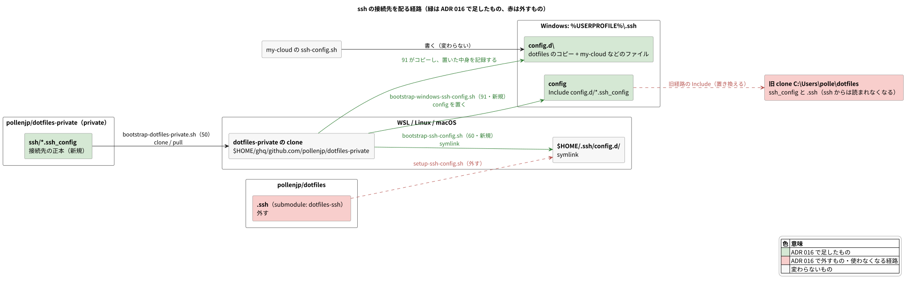
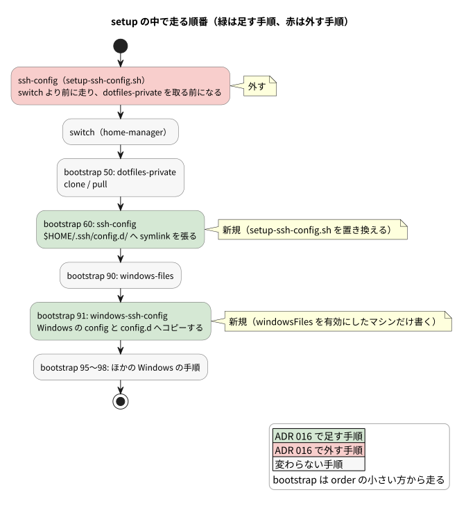
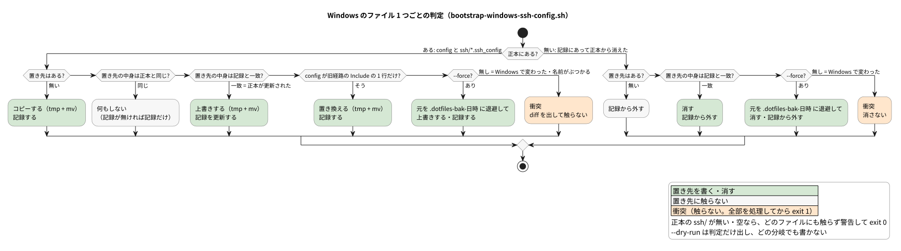
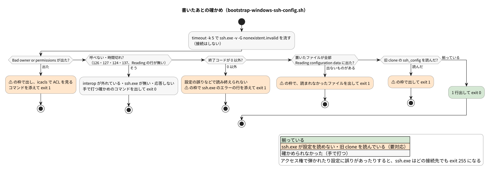

# ADR: ssh の接続先を dotfiles-private へ移し、WSL と Windows の両方へ配る

| 項目 | 内容 |
| --- | --- |
| ステータス | 提案 (Proposed) — レビュー中 |
| 日付 | 2026-10-12 (JST) |
| 決定者 | pollenjp |
| チケット | [TKT-145](https://app.notion.com/p/Windows-OS-Windows-ssh-3f779149a66f81c4a2cff0233027c26e)（読んだファイルを確かめる手順は [TKT-147](https://app.notion.com/p/ssh-Host-ssh-v-G-WSL-ssh-exe-3f779149a66f81d7b64bfdf440b4c650)） |
| 前提 ADR | [003_nix_ssh_config](../003_nix_ssh_config_20260810T210714JST/README.md)（`~/.ssh/config` は `Include` の骨組みだけを Nix で生成し、中身は `.ssh` submodule を `~/.ssh/config.d/` へ張る）、[004_nix_wsl_ssh_wrapper](../004_nix_wsl_ssh_wrapper_20260811T124616JST/README.md)（WSL の `ssh` は Windows の `ssh.exe` を呼ぶラッパー）、[010_win_files_from_wsl](../010_win_files_from_wsl_20260928T003933JST/README.md)（Windows 側へは WSL の bootstrap が `/mnt/c` へコピーして配り、Windows 側で変わっていたら止める）、[013_remove_legacy_tree](../013_remove_legacy_tree_20261007T015646JST/README.md)（旧経路を消し、`.ssh` submodule は残した）、[015_win_google_ime_powertoys](../015_win_google_ime_powertoys_20261011T234247JST/README.md)（公開したくない設定は `pollenjp/dotfiles-private` に置き、`bootstrap-dotfiles-private.sh` が取る） |
| 運用手順 | [`win/README.md`「ssh の設定」](../../../win/README.md)、[`nix/README.md`「ssh について」](../../../nix/README.md#ssh-について) |

---

## 1. 背景 (Context)

### やりたかったこと

Windows OS 側の設定をどう置くかの方針を決めたい (TKT-145)。最初の対象は、Windows 側の
`~/.ssh` (`%USERPROFILE%\.ssh`) の設定。

旧経路では、Git Bash の `main.bash setup` が Windows の `~/.ssh/config` の先頭に
`Include ~/dotfiles/ssh_config` を足し、Windows 側の clone (`C:\Users\polle\dotfiles`) の
`ssh_config` と `.ssh` submodule を読ませていた。ADR 013 で旧経路を消したあと、この clone は
pull しない約束で凍結している。

### 設計を縛る事実

#### 1. WSL の ssh は、Windows の ssh.exe が読む設定で動く

1Password を使う WSL のマシンでは、`~/.local/bin/ssh` は `ssh.exe` を呼ぶだけのラッパーで、
`-F` を渡さない (ADR 004)。そのため `ssh.exe` は Windows 側の `%USERPROFILE%\.ssh\config` を読み、
WSL 側の Nix 管理の `~/.ssh/config` が効くのは `USE_LINUX_SSH=1` のときだけになる。

```bash
# nix/files/bin/ssh-wsl.sh
use_linux_ssh="${USE_LINUX_SSH:-"0"}"
if [[ "${use_linux_ssh}" == "0" ]]; then
  exec ssh.exe "$@"
else
  exec /usr/bin/ssh "$@"
fi
```

#### 2. Windows 側の接続先は、凍結中の旧 clone から来ている

2026-10-12 にこの PC で `ssh.exe -v -G` を流すと、次の順で読んでいた (`-G` は接続しない。
確かめ方は TKT-147)。ファイル名は伏せ、同じ形の行はまとめた。

```text
$ ssh.exe -v -G nonexistent.invalid 2>&1 | grep 'Reading configuration'
debug1: Reading configuration data C:\\Users\\polle/.ssh/config
debug1: Reading configuration data C:\\Users\\polle/dotfiles/ssh_config
debug1: Reading configuration data C:\\Users\\polle/dotfiles/.ssh/<名前>.ssh_config     ← 5 行
debug1: Reading configuration data C:\\Users\\polle/.ssh/config.d/<名前>.ssh_config     ← 3 行
```

- `C:\Users\polle\.ssh\config` の中身は `Include ~/dotfiles/ssh_config` の 1 行だけ
- 旧 clone の `.ssh` submodule は `4a625cd` (2025-12-07) で、WSL 側の checkout (`83211b3`、
  2026-01-07) より 2 commit 古い。3 ファイルの中身が違い、1 ファイルは旧 clone にしか無い
- 旧 clone を pull すると `ssh_config` が消える。存在しない `Include` を ssh は黙って飛ばす
  (ADR 003 の検証) ので、エラーも出ずに接続先がまとめて消える

#### 3. Windows の config.d には、ほかのツールも書く

my-cloud の `gcp-sdbx-v2/scripts/ssh-config.sh` は、WSL から `%USERPROFILE%\.ssh\config.d\` へ
Host を書く。前提は「`~/.ssh/config` は `Include config.d/*.ssh_config` の 1 行で、ファイル名の
順が優先順位」。

```bash
# dotfiles (Nix 経路) の ~/.ssh/config は
#   Include config.d/*.ssh_config
# の 1 行だけなので、ここへファイルを置けば効く。ファイル名の順序が
# 優先順位になる (ssh は最初に得た値を採る)。実効値は `ssh -G <host>` で見る。
#
# WSL では ssh 自体が Windows 側の ssh.exe に差し替わっている (dotfiles が
# ~/.local/bin/ssh を置き換える) ため、設定は Windows 側の %USERPROFILE% に書く。
```

#### 4. 今の Windows と WSL では、読む順 (= 優先順位) が違う

ssh は同じキーについて最初に得た値を使う。WSL は `config.d` をファイル名の順に読むので、
`Host *` の既定値を持つ `zzz.ssh_config` は最後になる。今の Windows は旧 clone の submodule
(`zzz.ssh_config` を含む) を `config.d` より先に読むので、既定値が my-cloud の Host より強い。

| 読む順 | WSL (`config.d` のファイル名順) | 今の Windows (旧 clone が先) |
| --- | --- | --- |
| 先 (強い) | my-cloud などのファイル | submodule のファイル |
| | submodule のファイル | `zzz.ssh_config` (`Host *`) |
| 後 (弱い) | `zzz.ssh_config` (`Host *`) | my-cloud などのファイル |

今は重なるキーが無い (`zzz.ssh_config` の `Host *` は `TCPKeepAlive` だけで、my-cloud のファイルには
無い) ので実害は無いが、`Host *` にキーを足すと WSL と Windows で効く値がずれ始める。

#### 5. ssh.exe は Include したファイルのアクセス権を見る

`ssh.exe` 10.0 は、`-F` で渡したファイルのアクセス権は見ないが、そこから `Include` したファイルは
見る。WSL から `%TEMP%` に書いたファイルを `Include` すると、`%TEMP%` に付いている
`CodexSandboxUsers` の ACE を継承していたため `Bad owner or permissions` になり、exit 255 で止まった。
`%USERPROFILE%\.ssh` に付いているのは、SYSTEM・Administrators・本人の 3 者が継承する ACE だけ。

```text
$ icacls.exe 'C:\Users\polle\.ssh'
C:\Users\polle\.ssh NT AUTHORITY\SYSTEM:(I)(OI)(CI)(F)
                    BUILTIN\Administrators:(I)(OI)(CI)(F)
                    PJP-RAIDEN\polle:(I)(OI)(CI)(F)
```

#### 6. ssh.exe は相対の Include を %USERPROFILE%\.ssh\ 基準で解き、LF の設定を読む

WSL から LF で書いた使い捨ての config (`Include config.d/*.ssh_config` の 1 行と日本語のコメント)
を `-F` で渡すと、`C:\Users\polle/.ssh/config.d/` の 3 ファイルを読んだ。

#### 7. submodule は、接続先を変えるたびに指す先を進める commit が要る

`.ssh` submodule (`pollenjp/dotfiles-ssh`) を変えたら、public なこの repo でも指す先を進める
commit が要り、各マシンでは手で `git submodule update` を打つ。ADR 015 は同じ理由で、
dotfiles-private を submodule にしなかった。

## 2. 決定 (Decision)



### A. 接続先の正本を pollenjp/dotfiles-private の ssh/ へ移す

- `pollenjp/dotfiles-ssh@83211b3` の `*.ssh_config` 4 ファイルを、dotfiles-private の `ssh/` へ
  そのまま写す。履歴は持ってこず、commit の本文に写した元を書く
- dotfiles-ssh の `Makefile` (known_hosts を消すだけ) は持ってこない
- この repo から `.ssh` submodule と `.gitmodules` を外す
- 取るのは今ある `bootstrap-dotfiles-private.sh` (order 50) で、`setup --update` のたびに
  clone か pull する

### B. WSL・Linux・macOS へは bootstrap-ssh-config.sh (order 60) が symlink を張る



- `setup-ssh-config.sh` を置き換え、setup の `ssh-config` 手順を外す。今の手順は switch より前、
  つまり dotfiles-private を取る前に走り、新しいマシンでは 2 回目の setup まで張られないため
  (switch より前に置いたのは順序の制約ではないと、`setup-ssh-config.sh` 自身に書いてある)
- 張り方は `setup-ssh-config.sh` を引き継ぐ。張る元を指す symlink を外してから張り直し、消えた
  ファイルを指す symlink を残さない。`~/.ssh` と `config.d` を 700 にし、`~/.ssh/config` が
  Nix 管理かどうかを報告する
- 外す対象に、旧 submodule (`<dotfiles の checkout>/.ssh/`) を指す symlink を足す
- 同じ名前の通常のファイルや、ほかの場所を指す symlink があれば上書きせず、警告して飛ばす (exit 0)。
  今の `ln -sfn` は上書きしてしまう
- 正本の `ssh/` が無い・空なら、何も外さず張らずに警告して exit 0 にする
- dotfiles-private の場所は `bootstrap-dotfiles-private.sh` と同じ規則 (`$DOTFILES_PRIVATE_DIR` →
  `$(ghq root)/github.com/pollenjp/dotfiles-private` → `~/ghq/github.com/pollenjp/dotfiles-private`) で決める
- macOS の `readlink` には `-f` が無いので、今の `setup-ssh-config.sh` と同じく symlink を手で辿る
- 旧 submodule の作業ツリー (`<checkout>/.ssh/.git`) が残っていたら、消してよいと 1 行で知らせる
  (自分では消さない)

### C. Windows へは bootstrap-windows-ssh-config.sh (order 91) がコピーする

- 対象は、home-manager が置く `windows-files.json` の `enable` が true のマシン
  (bootstrap-windows-files.sh と同じ判定)。新しい host option は足さない
- `%USERPROFILE%\.ssh\config` を、WSL の Nix 管理の `~/.ssh/config` と同じ
  `Include config.d/*.ssh_config` の 1 行にし、説明のコメントを添える。Windows では手で開いて
  書き換えられる (WSL 側は store への読み取り専用の symlink) ので、コメントで持ち主を示す

  ```text
  # dotfiles の nix/scripts/bootstrap-windows-ssh-config.sh が置く (手で直すと次の setup で衝突になる)。
  # マシン固有の Host は config.d\ に <名前>.ssh_config として置く。
  # config.d はファイル名の順に読み、同じキーは先に読んだ値が効く。
  Include config.d/*.ssh_config
  ```

- dotfiles-private の `ssh/` 直下の `*.ssh_config` (通常のファイルだけ) を、名前を変えずに `config.d\` へコピーする。
  my-cloud などが書いたファイルには触らない
- 置いた中身の sha256 を、WSL 側の `~/.local/state/dotfiles/windows-ssh-config.deployed.json`
  (`.ssh` からの相対パス → sha256) に覚える。bootstrap-windows-files.sh の記録とは分ける
  (消す規則が違うため)

1 ファイルずつ、次のように判定する。



| 場合 | 置き先の今の中身 | すること |
| --- | --- | --- |
| 正本にある | 無い | コピーして記録する |
| 正本にある | 正本と同じ | 何もしない (記録が無ければ記録だけする) |
| 正本にある | 記録と同じ | 上書きする (正本の更新) |
| `config` だけ | `Include ~/dotfiles/ssh_config` の 1 行だけ (CR・行の前後の空白・空行は無視) | 置き換える (旧経路からの移行) |
| 正本にある | それ以外 | 衝突 (`--force` なら退避して上書き) |
| 正本から消えた | 無い | 記録から外す |
| 正本から消えた | 記録と同じ | 消して記録から外す |
| 正本から消えた | それ以外 | 衝突 (`--force` なら退避して消す) |

- bootstrap-windows-files.sh と同じところ: 判定の骨組み、衝突は全部を処理してから ⚠ の枠で出して
  exit 1 にすること、同じディレクトリの一時ファイルに書いてから mv すること
- 違うところ:
  - 正本から消えたファイルを消す。`win/` のファイルはアプリが持つので消さないが、ssh では古い
    接続先を残したくない
  - `config` が旧経路の 1 行だけなら、衝突にせず置き換えて、置き換えたと 1 行出す
  - `--force` は元を `<名前>.dotfiles-bak-<日時>` に退避してから上書き・削除する。Windows の
    `config` に手で書いた Host を失わないため。退避の名前は `*.ssh_config` で終わらないので
    `Include` されない
- 一時ファイルの名前 (`<名前>.dotfiles-tmp.XXXXXX`、bootstrap-windows-files.sh と同じ) も
  `*.ssh_config` で終わらないので、書いている途中に ssh.exe が読んでも `Include` されない
- `.ssh` と `config.d` が無ければ作り、ACL は Windows の継承に任せる
- 正本の `ssh/` が無い・空なら、何も書かず消さずに警告して exit 0 にする (取り損ねで全部消さない)
- `--dry-run` は判定だけ出し、何も書かず、確かめも流さない

### D. 書いたあとに ssh.exe -v -G で読んだファイルを確かめる



- 確かめ方は TKT-147 の手順で、`ssh.exe -v -G nonexistent.invalid` の
  `Reading configuration data` の行を見る
- `Bad owner or permissions` が出た・置いたファイルが読まれていない・旧 clone の `ssh_config` を
  読んだ、のどれかなら ⚠ の枠で出して exit 1 にする。アクセス権で弾かれると、ssh.exe はどの
  接続先でも exit 255 になるため。アクセス権のときは `icacls` で `.ssh` の ACL を見るコマンドを添える
- interop が外れて ssh.exe を呼べないときは、手で打つ確かめのコマンドを出して exit 0 にする
  (bootstrap-windows-powershell-profile.sh と同じ扱い)
- ⚠ の枠は bootstrap-windows-openssh.sh と同じ形 (`⚠️ ━━━ ⚠️` の行で挟む) にする。setup の最後に
  警告をまとめて出す話 (TKT-146) には、そちらで載せる

| 終わり方 | exit |
| --- | --- |
| 揃った・書いた・対象外 (`enable` が false)・`windows-files.json` が無い | 0 |
| dotfiles-private の `ssh/` が無い・空 (警告だけ出し、何も変えない) | 0 |
| ssh.exe を呼べない (手で打つ確かめのコマンドを出す) | 0 |
| 衝突が 1 件以上 (全部を処理してから) | 1 |
| 確かめで、アクセス権・読まれないファイル・旧 clone のどれかが見つかった | 1 |
| 引数の誤り | 2 |

### E. 移行は dotfiles-private → この repo → 各マシンの順で進める

1. dotfiles-private に `ssh/` と README の節を足す
2. この repo の変更 (bootstrap 2 本・テスト・submodule と `ssh-config` 手順を外す・文書) を merge する
3. 各マシンで `~/dotfiles/setup --self-update --update` を流す
4. 全マシンが移ったら、GitHub で `pollenjp/dotfiles-ssh` を archive する

正本が無いうちは 60 も 91 も何も外さず消さないので、2 を先に merge しても壊れない。そのあいだ
WSL の symlink は旧 submodule を指したまま、Windows は旧 clone を読んだまま動く。my-cloud の
コメントにある「dotfiles の .ssh submodule」は、別の repo なので別に直す。

## 3. 変更点の詳細

| ファイル | 変更 |
| --- | --- |
| `nix/scripts/bootstrap-ssh-config.sh` | 新規 (order 60)。`setup-ssh-config.sh` を置き換える |
| `nix/scripts/bootstrap-windows-ssh-config.sh` | 新規 (order 91) |
| `nix/scripts/setup-ssh-config.sh` | 削除 |
| `nix/scripts/setup.sh` | `ssh-config` 手順を外す (`add_step`・preset・手順の対応)。self-update の `--ignore-submodules=all` を外す |
| `.gitmodules`・`.ssh` (gitlink) | 削除 |
| `nix/tests/bootstrap-ssh-config.test.sh` | 新規 |
| `nix/tests/bootstrap-windows-ssh-config.test.sh` | 新規 |
| `nix/flake.nix` | checks に 2 本のテストを足す |
| `nix/home/modules/ssh.nix` | コメントの「.ssh submodule」を dotfiles-private に直す |
| `nix/scripts/bootstrap-dotfiles-private.sh` | 説明に ssh の設定を足す |
| `nix/README.md` | 手順表から `ssh-config` を外し、「ssh について」と bootstrap の並びを直す |
| `README.md` | ディレクトリ表の `.ssh` の行を外し、接続先の置き場所を書く |
| `win/README.md` | 「ssh の設定」の節を足す |
| ADR 003 / 013 / 015 | 冒頭に後続 ADR (016) のポインタだけ足す (本文は書き換えない) |
| `pollenjp/dotfiles-private` (別の repo) | `ssh/*.ssh_config` と README の節 |

## 4. 検討した代替案

### 接続先の正本

| 案 | 採らなかった理由 |
| --- | --- |
| `.ssh` submodule のまま、WSL の checkout から Windows へコピーする | 接続先を変えるたびに、この repo で指す先を進める commit と、各マシンでの submodule の更新が要り続ける |
| 今回は submodule のまま配り、dotfiles-private への移行は別チケットにする | 配る仕組みを submodule 向けに作ってから、もう一度作り直すことになる |

### Windows への置き方

| 案 | 採らなかった理由 |
| --- | --- |
| dotfiles 専用のディレクトリ (`dotfiles.d\`) を丸ごと鏡写しにし、`config` で `dotfiles.d` → `config.d` の順に `Include` する | 作る量は少ないが、dotfiles のファイルが先に読まれ、`Host *` の既定値が my-cloud の Host より強くなる (事実 4 のずれが残る) |
| Windows の `config` から WSL のファイルを `\\wsl.localhost\…` で直接 `Include` する | WSL が止まっていると読めず、PowerShell から直接打つ ssh も WSL に頼る。ssh.exe が UNC パスを読めるか・symlink を辿れるか・ACL で弾かれないかを確かめていない |
| `win/manifest.toml` に `config` を足して bootstrap-windows-files.sh で配る | 旧経路の 1 行の置き換えと、正本から消えたファイルを消す規則が入らない。`--force` がほかのファイルの衝突にも効く。private な接続先は `win/` に置けない (`src` は `win/` の下の通常のファイルに限る) |

### WSL 側の張り直しの置き場所

| 案 | 採らなかった理由 |
| --- | --- |
| setup の `ssh-config` 手順 (switch より前) を残し、張る元だけを変える | dotfiles-private を取る前に走るので、新しいマシンでは 2 回目の setup まで張られない |

## 5. 影響 (Consequences)

### 良くなること

- Windows の ssh (WSL の `ssh` と、PowerShell などから直接打つ ssh) が、凍結中の旧 clone に頼らなくなる
- 接続先を直したら、次の `setup --update` で WSL と Windows の両方に届く
- Windows の `config` が WSL と同じ形になり、優先順位の規則 (`config.d` のファイル名順) が 1 つになる。
  my-cloud の前提にもそのまま合う
- 接続先を変えても、この repo で指す先を進める commit が要らない

### 注意が必要なこと

- **Windows の `%USERPROFILE%\.ssh\config` は dotfiles が持つ。** 手で書き換えると次の setup で衝突になる。
  マシン固有の Host は `config.d\<名前>.ssh_config` に置く
- dotfiles-private を取れないマシン (鍵が無い・オフライン) では、ssh の設定は前の状態のまま更新されない
- Windows の旧 clone (`C:\Users\polle\dotfiles`) は ssh からは読まれなくなり、Git Bash のためだけに残る
- 1Password を使う WSL のマシンでは、WSL 側の symlink は ssh.exe に読まれない。`USE_LINUX_SSH=1` で
  Linux の ssh に落としたとき用に張り続ける
- submodule を外す commit を pull しても、各マシンの `<checkout>/.ssh/` の作業ツリーは残る見込み。
  消すのは手で行う

## 6. 検証 (Verification)

実装のあとに結果を書く。予定は次のとおり。

| 何を | どうやって |
| --- | --- |
| 2 本の bootstrap の振る舞い | `nix/tests/` のテスト (使い捨ての HOME・Windows のホーム・dotfiles-private と、偽の `ssh.exe`)。flake の checks で流す |
| この PC での初回 | `bootstrap-windows-ssh-config.sh --dry-run` の判定を見てから本番を流し、`ssh.exe -v -G nonexistent.invalid` で旧 clone を読まず `config.d` の 7 件を読むことを見る |
| 接続 | `ssh -T git@github.com` が通り、my-cloud の Host の `ssh -G` の値が変わらない |
| WSL 側 | `USE_LINUX_SSH=1 ssh -G github.com` で、新しい symlink が読まれる |

`nix/scripts/verify.sh` は実機の user systemd に触るので流さず、flake check と check の build で確かめる。

## 7. 移行・運用手順

### この PC

dotfiles-private の変更とこの repo の変更を merge したあとに流す。

```bash
~/dotfiles/setup --self-update --update
ssh.exe -v -G nonexistent.invalid 2>&1 | grep 'Reading configuration'   # 旧 clone の ssh_config が出ないこと
```

submodule の作業ツリーが残っていれば消す (setup が 1 行で知らせる)。

```bash
rm -rf ~/ghq/github.com/pollenjp/dotfiles/.ssh ~/ghq/github.com/pollenjp/dotfiles/.git/modules/.ssh
```

### 会社の PC

同じく setup を流す。Windows の `config` に手で書いた Host があれば衝突で止まるので、diff を見て
`config.d\<名前>.ssh_config` へ移してから、次を打つ (元は `.dotfiles-bak-<日時>` に残る)。

```bash
~/ghq/github.com/pollenjp/dotfiles/nix/scripts/bootstrap-windows-ssh-config.sh --force
```

### 接続先を足す・直す

dotfiles-private の `ssh/` を直して commit・push し、各マシンで `~/dotfiles/setup --update` を流す。

### Windows で dotfiles のファイルを直したくなったら

`config.d\` の dotfiles のファイルを Windows で直すと、次の setup で衝突として止まる。直した中身を
dotfiles-private の `ssh/` へ取り込んで commit するか、`--force` で上書きする。
