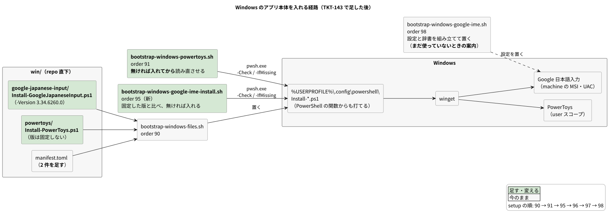
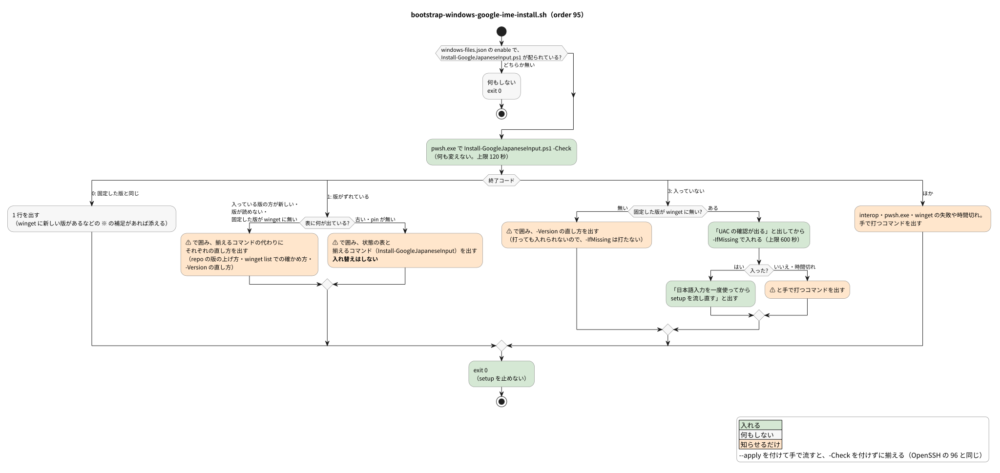
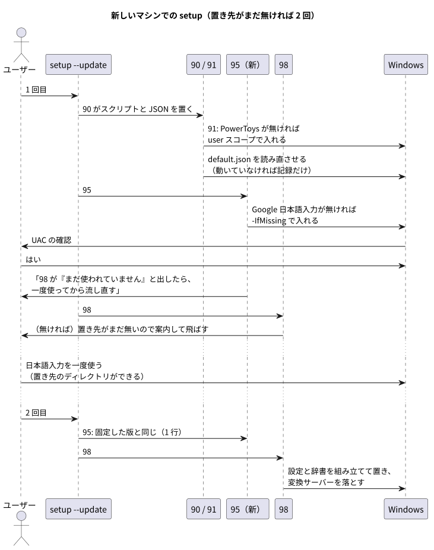

# ADR: Windows の Google 日本語入力と PowerToys を、setup の中で winget から入れる

| 項目 | 内容 |
| --- | --- |
| ステータス | 提案 (Proposed) — レビュー中 |
| 日付 | 2026-10-12 (JST) |
| 決定者 | pollenjp |
| チケット | [TKT-143](https://app.notion.com/p/winget-Windows-Google-PowerToys-Google-dotfiles-3f779149a66f817a8944c9e4e460383f) |
| 前提 ADR | [015_win_google_ime_powertoys](../015_win_google_ime_powertoys_20261011T234247JST/README.md)（2 つのアプリの設定を repo のテキストから配る）、[010_win_files_from_wsl](../010_win_files_from_wsl_20260928T003933JST/README.md)（`win/` を WSL の bootstrap が `/mnt/c` へ配る） |
| 運用手順 | [`win/README.md`「Google 日本語入力を入れる」「PowerToys を入れる」](../../../win/README.md)、[`nix/README.md`「bootstrap の実行順」](../../../nix/README.md#bootstrap-の実行順) |

---

## 1. 背景 (Context)

### やりたかったこと

- ADR 015 で、Google 日本語入力と PowerToys の **設定** は repo のテキストから配るようになった
- ただ、アプリの **本体** はまだ手で入れている。新しいマシンでは、2 つを入れてから setup を流す必要がある
- 新しいマシンで `~/dotfiles/setup --update` を流すだけで揃うよう、winget で入れる工程を足す (ユーザーの提案)

### 範囲 (TKT-143 で決めた)

| 入れる | 入れない |
| --- | --- |
| Google 日本語入力 (winget の `Google.JapaneseIME`)。版を固定する | 既定の入力方式を Google 日本語入力にする設定 (Windows の言語設定) |
| PowerToys (winget の `Microsoft.PowerToys`)。版は固定しない | PowerToys のほかのモジュールの設定・有効化 |
| 入っていないときに入れる・版のずれを知らせる | 入っていない状態からの確かめ (この PC では 2 つを消すことになるため。次の新しいマシンで確かめる) |

### 設計を縛る事実

#### 1. 2 つとも winget にあり、手で入れたものも ID で見える

この PC の 2 つは winget で入れていないが、`winget list --id <ID> --exact` で ID と版が出た (2026-10-12)。

```text
Name              Id                 Version     Available   Source
Google 日本語入力 Google.JapaneseIME 2.29.5370.0 3.34.6260.0 winget

Name                    Id                  Version Available    Source
PowerToys (Preview) x64 Microsoft.PowerToys 0.100.2 0.101.2362.0 winget
```

#### 2. Google 日本語入力は machine スコープの MSI だけで、管理者権限が要る

winget-pkgs の `Google.JapaneseIME` 3.34.6260.0 の installer manifest は `InstallerType: wix`・`Scope: machine` の 1 つだけ。
入れるときは Windows のデスクトップに UAC の確認が出る。WSL から流していても、確認は Windows 側に出る。

#### 3. PowerToys は user スコープで入れられる

`Microsoft.PowerToys` 0.101.2362.0 の manifest には user スコープ (`PowerToysUserSetup-…exe`) と machine スコープ (`ElevationRequirement: elevatesSelf`) の 2 つがある。
この PC は user スコープで、`%LOCALAPPDATA%\PowerToys\PowerToys.exe` (0.100.2.0) にある。

#### 4. この PC の Google 日本語入力は 2.29 のまま止まっている

- `C:\Program Files (x86)\Google\Google Japanese Input\GoogleIMEJaConverter.exe` の ProductVersion は `2.29.5370.0` (FileVersion は `2.29.5370.0  (build 63)`)
- winget の最新は `3.34.6260.0` (2026-07-27)。この PC では自分で上がっていない
- 3.34 の MSI は x64 (`GoogleJapaneseInput64-3.34.6260.0.msi`) なので、置き場所が `C:\Program Files\Google\Google Japanese Input\` に変わるかもしれない

#### 5. pjp-google-ime の .proto は 3.34 より新しい

ADR 015 で写した Mozc の commit (`18e76511…`) は 2026-10-09 のもので、Mozc の tag `3.34.6239` より後にある。3.34 で足された設定の項目も読めるはず。

#### 6. 前例は herdr (order 97) と OpenSSH (order 96)

どちらも `win/` に置いた PowerShell のスクリプトを bootstrap-windows-files.sh (order 90) が `%USERPROFILE%\.config\powershell\` へ配り、bootstrap が `pwsh.exe` で呼ぶ。

| | OpenSSH (96) | herdr (97) |
| --- | --- | --- |
| 版 | `Install-OpenSSH.ps1` の `-Version` の既定値で固定 | `Install-Herdr.ps1` の `-Version` の既定値で固定 |
| 入っていない | 知らせるだけ | `-IfMissing` で入れる |
| ずれている | ⚠ で知らせ、揃えるのは手で打つ (UAC が要り、動いている ssh も巻き込むため) | ⚠ で知らせ、揃えるのは手で打つ |
| テスト | 副作用の無い関数を `Install-OpenSSH.Tests.ps1` (Linux の pwsh。Pester は使わない)、bootstrap は偽の `pwsh.exe` | 同じ |

#### 7. Keyboard Manager は default.json の前に settings.json を読む

PowerToys の `MappingConfiguration::LoadSettings` は、Keyboard Manager の `settings.json` の `activeConfiguration` (有効なプロファイルの名前) を読み、その名前の JSON (`default.json`) を読む。
入れた直後に `settings.json` ができるかは、入っていない状態から試さないと分からない。

#### 8. 98 の置き先は、日本語入力を初めて使ったときにできる

98 が置く `AppData/LocalLow/Google/Google Japanese Input` は、Google 日本語入力のプロセスが初めて起動したときにできる。入れただけのマシンでは、まだ無い。
Mozc の `UserProfileDirectoryImpl::GetDir()` (`src/base/system_util.cc`) が、初めて呼ばれたときに `FileUtil::CreateDirectory` で作る。

---

## 2. 決定 (Decision)



### A. Google 日本語入力は版を固定し、新しい bootstrap 95 が確かめる

`win/google-japanese-input/Install-GoogleJapaneseInput.ps1` を足す (herdr の `Install-Herdr.ps1` と同じ形)。

| 引数 | すること |
| --- | --- |
| `-Version` | 固定する版。既定値は `3.34.6260.0`。版を上げるときはここを変える |
| `-Check` | 何も変えずに状態の表を出す。揃っていれば 0、ずれていれば 1、入っていなければ 3、失敗は 2 |
| `-IfMissing` | 入っていなければ固定した版を入れ、winget pin を足す。入っていれば `-Check` と同じ |
| (付けない) | 揃える。古ければ固定した版へ上げる。新しいときは下げずに、repo の版を上げるよう案内して 1 |

- 版は `GoogleIMEJaConverter.exe` の ProductVersion で読む。`C:\Program Files\` と `C:\Program Files (x86)\` の両方を見る
- 入れたら winget pin を足す。`winget upgrade --all` で勝手に上がらないようにするため (herdr・OpenSSH と同じ)
- 状態の表には、入っている版・固定した版・winget の最新版・pin の有無を出す

`nix/scripts/bootstrap-windows-google-ime-install.sh` (order 95) を足す。



| `-Check` | 95 がすること |
| --- | --- |
| 0 | 1 行を出す (winget に新しい版があるなどの ※ の補足があれば、それも添える) |
| 1 | ⚠ で囲み、状態の表と揃えるコマンド (`Install-GoogleJapaneseInput`) を出す。入っている版の方が新しい・版が読めない・固定した版が winget に無いときは、打っても直らないので、揃えるコマンドの代わりにそれぞれの直し方 (repo の版の上げ方・`winget list` での確かめ方・`-Version` の直し方) を出す |
| 3 | `-IfMissing` で入れる。UAC の確認が出ることを先に出し、上限 600 秒で待つ。固定した版が winget に無ければ、打っても入れられない (UAC も出ない) ので入れにいかず、`-Version` の直し方を出す |
| ほか | interop・pwsh.exe・winget の失敗や時間切れ。手で打つコマンドを出して飛ばす |

- どの場合も exit 0 (setup を止めない)。`--apply` を付けて手で流すと、`-Check` を付けずに流して揃える (OpenSSH の 96 と同じ)
- 揃える (入れ替える) のは setup からはしない。日本語入力は全部のアプリに読み込まれていて、入れ替えるとアプリや Windows の再起動が要ることがあるため
- 入っていないときだけは setup の中で入れる。新しいマシンでは、その場にいて UAC を押せるはずだから

### B. PowerToys は版を固定せず、91 が無ければ入れる

`win/powertoys/Install-PowerToys.ps1` を足す。

| 引数 | すること |
| --- | --- |
| `-Check` | 入っていれば 0、入っていなければ 3、失敗は 2 |
| `-IfMissing` | 入っていなければ user スコープで入れる。入っていれば `-Check` と同じ |

- 入っているかは `PowerToys.exe` が `%LOCALAPPDATA%\PowerToys\` か `C:\Program Files\PowerToys\` にあるかで見る
- pin は足さない。PowerToys は自分で更新を知らせる
- bootstrap-windows-powertoys.sh (91) は、default.json を読み直させる前に `-Check` を流し、3 なら `-IfMissing` で入れる
- 入れられなかったら ⚠ を出して、読み直しへ進む。91 は今までどおり 2 以外で 0 以外を返さない

### C. 98 は「入っているが、まだ使っていない」を見分けて案内する

- IME のディレクトリが無いとき、`GoogleIMEJaConverter.exe` が 2 つの Program Files のどちらかにあれば、「日本語入力を一度使ってから setup を流し直す」と出して exit 0
- 無ければ今までどおり「Google 日本語入力が入っていません」で飛ばす
- ディレクトリを先に作って置くことはしない。Google 日本語入力が作るときの権限と揃わないおそれがある
- `--import` が commit していない変更を確かめる範囲は、`win/google-japanese-input/` では、取り込みが書き換える `config.txtpb`・`keymap.tsv`・`romaji.tsv` だけに絞る (dotfiles-private の辞書は今までどおり)。同じディレクトリの `Install-GoogleJapaneseInput.ps1` の変更で止まると、§7 の「版を上げる」(`-Version` を変えてから、commit する前に `--import` で確かめる) が通らないため

### D. 入れるマシンは windowsFiles.enable のマシン

herdr と同じく、`dotfiles.wsl.windowsFiles.enable` のマシン (今は `pollenjp@wsl` だけ) で入れる。入れるかどうかの option は足さない。

### E. スクリプトの配り方とテストは herdr にそろえる

- `win/manifest.toml` に 2 件足す (置き先は `%USERPROFILE%/.config/powershell/`)
- `win/powershell/dotfiles.ps1` に `Install-GoogleJapaneseInput` と `Install-PowerToys` の関数を足す
- スクリプトは BOM 付きの UTF-8 で保存する (Windows PowerShell 5.1 のため)
- 副作用の無い関数は `*.Tests.ps1` で確かめる (Linux の pwsh で手で流す。manifest に載せないので配られない)
- bootstrap は偽の `pwsh.exe` で確かめ、flake の checks に載せる

---

## 3. 変更点の詳細

| ファイル | 変更 |
| --- | --- |
| `win/google-japanese-input/Install-GoogleJapaneseInput.ps1` | 新規。決定 A |
| `win/google-japanese-input/Install-GoogleJapaneseInput.Tests.ps1` | 新規。副作用の無い関数のテスト |
| `win/powertoys/Install-PowerToys.ps1` | 新規。決定 B |
| `win/powertoys/Install-PowerToys.Tests.ps1` | 新規。副作用の無い関数のテスト |
| `nix/scripts/bootstrap-windows-google-ime-install.sh` | 新規。order 95 |
| `nix/scripts/bootstrap-windows-powertoys.sh` | 読み直させる前に、無ければ入れる |
| `nix/scripts/bootstrap-windows-google-ime.sh` | 入っているが使っていないときの案内。`--import` の、commit していない変更の確かめを 3 つのテキストに絞る (決定 C) |
| `nix/tests/bootstrap-windows-google-ime-install.test.sh` | 新規。偽の pwsh.exe |
| `nix/tests/bootstrap-windows-powertoys.test.sh`・`bootstrap-windows-google-ime.test.sh` | 足した分のテスト |
| `nix/flake.nix` | 新しい bootstrap のテストを checks に足す |
| `win/manifest.toml`・`win/powershell/dotfiles.ps1` | 2 つのスクリプトを配る・関数を足す |
| `win/README.md`・`nix/README.md` | 使い方 (「Google 日本語入力を入れる」「PowerToys を入れる」と、スクリプトを書くときの注意)・bootstrap の実行順・新しいマシンの手順・テストの表・ディレクトリの木 |
| `docs/adr/README.md` | 一覧に 017 を足す |
| `docs/adr/015_win_google_ime_powertoys_20261011T234247JST/README.md` | 冒頭の表に後続 ADR (この ADR) の行を置き、§7 (新しいマシンの手順と `--import` の文) を今の形にする (§1〜§6 の本文の決定はそのまま) |

---

## 4. 検討した代替案

| 案 | 中身 | 採らなかった理由 |
| --- | --- | --- |
| 案内だけ (案 A) | 入っていなければ、setup が winget のコマンドを ⚠ で出す | 新しいマシンで手で打つ一歩が残る |
| どちらも版を固定しない (案 B) | 無ければ入れるだけ | Google 日本語入力が勝手に上がると、.proto に無い項目が出たときに何が変わったのかを追えない |
| PowerToys も版を固定する | herdr と同じく固定して知らせる | PowerToys は自分で更新を知らせるので、そのたびに repo の版を上げる手間が増える。配っている JSON は版が上がっても形が変わりにくい |
| 98 がディレクトリを作って先に置く | 新しいマシンで setup を 1 回で済ませる | Google 日本語入力が作るときの権限と揃わないおそれがある。入っていない状態から確かめられない |
| 入れるかどうかの option を足す | windowsFiles.enable とは別に止められるようにする | 今は配るマシンが 1 台で、herdr も同じフラグで入れている。要るようになったら足す |
| 1 本のスクリプトで 2 つを扱う | 共通の winget の呼び方をまとめる | 版の扱いが違い、前例 (herdr・OpenSSH) が 1 つのアプリに 1 本なのにそろえる |
| bash から winget.exe を直に打つ | PowerShell のスクリプトを足さない | winget の終了コードが bash では 8 ビットに切れ、「無い」と「失敗」を見分けにくい。PowerShell から手で打つ入口も無くなる |

---

## 5. 影響 (Consequences)

- 新しいマシンでは setup を 2 回流す。1 回目で 2 つが入り、日本語入力を一度使ってから 2 回目で 98 が設定を置く

  

- Google 日本語入力が入っていないマシンで setup を流すと、UAC の確認が 1 回出る。押さないまま 600 秒たつと、⚠ と手で打つコマンドを出して先へ進む
- Google 日本語入力が自分で上がると、95 が ⚠ を出し続ける。repo の版 (`-Version` の既定値) を上げ、98 で設定を読み書きできるかを確かめてから commit する
- 95 がずれを知らせている間も、98 は今入っている版に設定を置く
- 閉包スキャン (ADR 006) には影響しない。入れるのは Windows 側のアプリで、Nix の閉包には入らない

---

## 6. 検証 (Verification)

設計の時点で確かめたこと (2026-10-12、この PC)。

| 確認 | 方法 | 結果 |
| --- | --- | --- |
| winget から見えるか | `winget list --id <ID> --exact` | 2 つとも ID と版が出た (§1 の 1) |
| インストーラの種類とスコープ | winget-pkgs の installer manifest | Google 日本語入力は machine の MSI だけ、PowerToys は user と machine (§1 の 2・3) |
| 版の読み方 | `GoogleIMEJaConverter.exe` の VersionInfo | ProductVersion が `2.29.5370.0` で、winget の版と同じ書き方 |
| PowerToys の場所 | `PowerToys.exe` の有無 | `%LOCALAPPDATA%\PowerToys\` にあり、`C:\Program Files\PowerToys\` には無い |

実装で確かめること (実装の PR で結果を埋める)。

| 確認 | 方法 | 結果 |
| --- | --- | --- |
| 副作用の無い関数 | `Install-GoogleJapaneseInput.Tests.ps1`・`Install-PowerToys.Tests.ps1` (Linux の pwsh) | — |
| bootstrap | nix/tests/ のテスト (偽の pwsh.exe) | — |
| 静的 | `nixfmt` / `shfmt` / `shellcheck` | — |
| 実機: 91 | PowerToys が入っているので、入れずに今までどおり読み直させる | — |
| 実機: 95 のずれ | 2.29.5370.0 と 3.34.6260.0 のずれを ⚠ で出す | — |
| 実機: 揃える | `Install-GoogleJapaneseInput` で 3.34.6260.0 に上げる (UAC)。上げた後の 95 は 1 行 | — |
| 実機: 上げた後の設定 | 98 の `--dry-run`・`--import` で、3.34 の設定と辞書を読み書きできる。句読点を変えて配ると効く | — |
| 新しいマシン | `-IfMissing` で 2 つが入る・setup を 2 回流すと揃う・Keyboard Manager が置いた割り当てを読む | まだ (次の新しいマシンで確かめる) |

---

## 7. 移行・運用手順

### この PC

1. merge の後に `~/dotfiles/setup --update` を流す。95 が「2.29.5370.0 と 3.34.6260.0 がずれている」と ⚠ で知らせる
2. 日本語入力を使っているアプリをできるだけ閉じ、PowerShell で `Install-GoogleJapaneseInput` を打つ (UAC を押す)
3. もう一度 `~/dotfiles/setup --update` を流し、95 が 1 行になり、98 が「同じです」か衝突を出すことを見る (衝突なら `--import` で取り込む)

### 新しいマシン

1. `~/dotfiles/setup --update` を流す。95 で UAC の確認が出たら押す
2. 日本語入力を一度使う (何か打つ)
3. もう一度 `~/dotfiles/setup --update` を流す。98 が設定と辞書を置く

### 版を上げる

1. `Install-GoogleJapaneseInput.ps1` の `-Version` の既定値を新しい版にする
2. `nix/scripts/bootstrap-windows-files.sh` を流して、書き換えたスクリプトを Windows へ配る (commit していなくても、作業ツリーのものが配られる。PowerShell の `Install-GoogleJapaneseInput` と 95 の `--apply` は、配ったスクリプトを呼ぶ)
3. この PC で `Install-GoogleJapaneseInput` を打って揃え、98 の `--dry-run` と `--import` で設定を読み書きできるかを見る
4. .proto に無い項目が出たら、`nix/pkgs/pjp-google-ime/proto/` の写しを新しくする (ADR 015)
