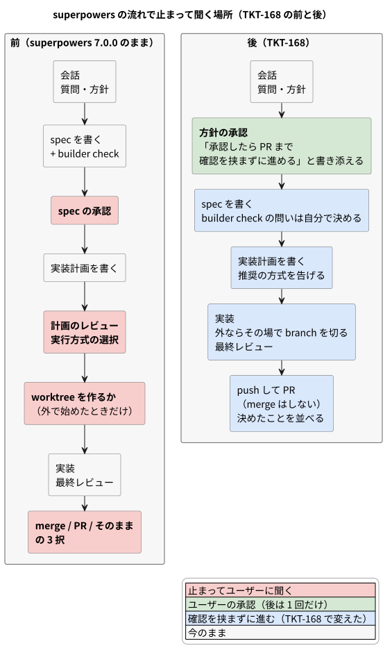
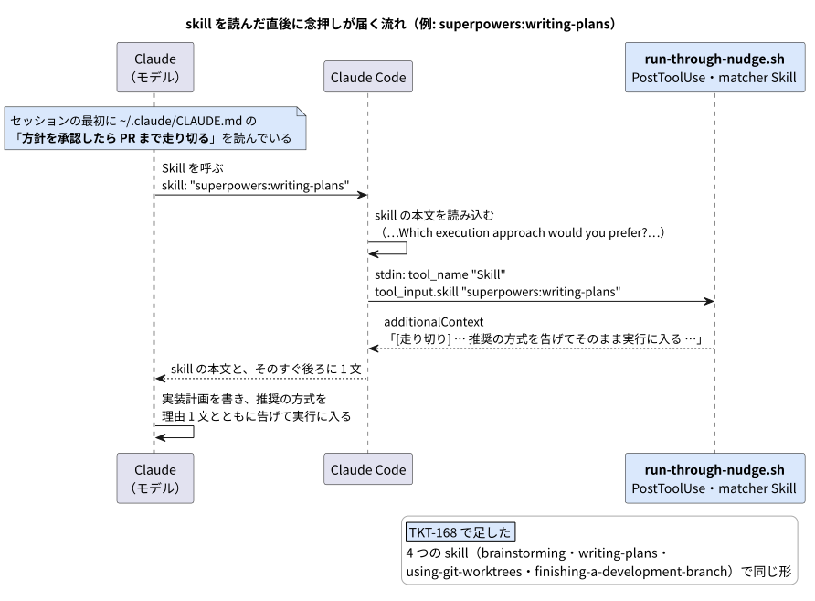

# ADR: superpowers で承認を求めるのは方針の 1 回だけにし、承認のあとは PR まで走り切らせる

| 項目 | 内容 |
| --- | --- |
| ステータス | 承認 (Accepted) — 方針は 2026-10-16 にユーザーが承認。文面は PR でレビュー |
| 日付 | 2026-10-16 (JST) |
| 決定者 | pollenjp |
| チケット | [TKT-168](https://app.notion.com/p/superpowers-spec-1-3fb79149a66f8155b551f793eb9d5691) |
| 運用手順 | [`nix/README.md`「方針を承認したら PR まで走り切らせるフック」](../../../nix/README.md#方針を承認したら-pr-まで走り切らせるフック) |

---

## 1. 背景 (Context)

### やりたかったこと

superpowers (Claude Code の plugin) の流れでは、設計の質問に答えて方針が決まったあと、
spec を書いて「この設計でよいか」、実装計画 (plan) を書いて「Subagent-driven か Native か」を
毎回聞かれる。ユーザーの言葉では次のとおり (TKT-168)。

> この２つ目のステップでいちいち効かれるのが面倒。基本的には native か subagent のどちらが推奨かまでは
> 判断してくれているのでその推奨された方針で実装まで走りきって欲しい。
> 叶うなら１つ目の方針で良いかを聞いてきたタイミングで、承認したら実装設計をしてから実装まで走り切る旨を
> 記載しておいてくれると親切だと思う。

実装のあとの「merge / PR / そのまま」の 3 択も、会話の中で「PR まで出す」をユーザーが選んだ。

### 止まって聞いている場所 (superpowers 7.0.0)

| 段階 | skill | 聞くこと |
| --- | --- | --- |
| spec を書いたあと | `brainstorming` (HARD-GATE) | 書いた spec を承認するか。7.0.0 からは、その前に builder check (subagent が spec を読んで問いを返す) の問いも 1 回だけ持ってくる |
| 実装計画を書いたあと | `writing-plans` (Execution Handoff) | 計画のレビューと実行方式 (Subagent-driven / Native)。推奨の方式は skill が理由つきで出す |
| 実行に入るとき | `using-git-worktrees` (Step 0) | worktree の外で始めたときだけ、worktree を作るか |
| 実装のあと | `finishing-a-development-branch` (Step 4) | merge / PR / そのまま の 3 択 |



### 設計を縛る事実

#### 1. superpowers はユーザーの指示を skill より優先すると書いている

`using-superpowers` の「User Instructions」:

```text
User instructions (CLAUDE.md, AGENTS.md, GEMINI.md, etc, direct requests) take precedence over skills, which in turn override default behavior. Only skip skill workflows or instructions when your human partner has explicitly told you to.
```

CLAUDE.md に明示すれば、2 つ目の確認を省くのは superpowers 自身が認める上書きになる。
plugin の中身は更新のたびに置き換わるので、直接は直さない。

#### 2. ただし skill の文面は承認を広げて読むことを強く戒め、しかも問いの直前に読まれる

7.0.0 の `brainstorming` の Red Flags:

```text
| "They said 'sounds good' to the idea" | Approval covers what you showed them. A description you haven't written isn't approved. |
```

CLAUDE.md はセッションの最初に読まれ、skill は問いを出す直前に読まれる。英語の skill を
読んだ直後に英語で返してしまった前例があり、CLAUDE.md の「応答の言語」にも注意が書いてある。
CLAUDE.md の 1 か所だけでは、直前に読んだ skill の文面につられうる。

#### 3. superpowers は更新が速い

この ADR を書いたセッションの途中で 6.4.1 から 7.0.0 に上がり、`brainstorming` が作り直された
(builder check が入った)。skill の名前 (`brainstorming`・`writing-plans`・`using-git-worktrees`・
`finishing-a-development-branch`) と、上の 4 か所の問いは保たれている。

#### 4. Skill の読み込みには PostToolUse の hook を付けられる

`claude -p` (2.1.299) に `--settings` で一時的な hook を渡して確かめた。matcher `Skill` の
PostToolUse は skill の読み込みで発火し、入力は次の形だった。

```json
{"hook_event_name":"PostToolUse","tool_name":"Skill","tool_input":{"skill":"superpowers:verification-before-completion"},"tool_response":{"success":true,"commandName":"superpowers:verification-before-completion"}}
```

hook が返した `additionalContext` は、その turn のうちにモデルへ届いた (モデルがその文を引用できた)。
一方、hook の `if` に `"Skill(superpowers:verification-before-completion)"` と書いた hook は発火しなかった。

#### 5. 解説動画の確認も設計の書き出しで割り込む

`video-offer-nudge.sh` は spec / ADR の新規作成で「解説動画を作るか」を知らせる。承認のあとに
spec を書くようにすると、走り切りの途中で動画の確認が割り込みうる。TKT-148 (dotfiles PR #126 /
claude-skills PR #80、この ADR の時点で open) の新しい `pjp-video-explainer-offer` は
「決まったことを記録するだけの ADR (承認済みの設計や、会話で決め終えたことを書き写したもの)」では作らない。

## 2. 決定 (Decision)

### A. CLAUDE.md に「方針を承認したら PR まで走り切る」節を足す

`nix/files/claude/CLAUDE.md` の「応答の言語」の直後に置く。Dev Tracker の有無によらず全マシンで効く
(常時部分)。文面:

```markdown
## 方針を承認したら PR まで走り切る

superpowers の流れ (brainstorming → writing-plans → 実行 → finishing) で承認を求めるのは
**方針の承認 1 回だけ**にする。superpowers の承認の関門 (spec の承認・実装計画のレビューと
実行方式の選択・実装後の 3 択) より、この節を優先する。

- 方針の承認を聞くとき「承認したら PR まで確認を挟まずに進める」と、その先の段階
  (spec → 実装計画 → 実装 → PR など) とともに書き添える。この承認を spec と実装計画の承認としても扱う
- 承認のあとは聞かずに進める。builder check の問いは自分で決めて spec に残し、実行方式は推奨を
  理由 1 文とともに告げ、worktree の外ならその場で feature branch を切り、実装後は push して
  PR を作る (merge はしない)
- 承認のあとに書く spec は承認済みの設計の書き写しなので、解説動画の対象にしない
- 止まるのは、取り消せない操作・セキュリティに関わる操作・merge や共有 branch への push・
  方針を覆す発見のときだけ。ユーザーがその会話で別の進め方を言えば従う
- 自分で決めたこと (builder check の判断・実行中の ruling) は、PR を返すときに並べる

skill を読んだ直後には hook (`~/.claude/hooks/run-through-nudge.sh`) も念を押してくる。
```

### B. 4 つの skill を読んだ直後に、PostToolUse の hook が 1 文を差し込む

`nix/files/claude/hooks/run-through-nudge.sh` を足す。matcher `Skill` の PostToolUse で動き、
`tool_input.skill` を見て、次の 4 つのときだけ `additionalContext` を返す。



| `tool_input.skill` | 差し込む文 |
| --- | --- |
| `superpowers:brainstorming` | [走り切り] superpowers:brainstorming を読んだ。このユーザーは方針の承認 1 回のあと PR まで走り切る (~/.claude/CLAUDE.md「方針を承認したら PR まで走り切る」)。方針の承認を聞くとき「承認したら PR まで確認を挟まずに進める」と、その先の段階 (spec → 実装計画 → 実装 → PR など) とともに書き添える。承認のあとは spec の承認を待たずに writing-plans へ進み、builder check の問いは自分で決めて spec に「こちらの判断」として残す。ユーザーがこの会話で別の進め方を言っていれば、そちらに従う。 |
| `superpowers:writing-plans` | [走り切り] superpowers:writing-plans を読んだ。実装計画を書いたら、計画のレビューも実行方式 (Subagent-driven / Native) の選択も聞かず、推奨の方式を理由 1 文とともに告げてそのまま実行に入る (~/.claude/CLAUDE.md「方針を承認したら PR まで走り切る」)。ユーザーがこの会話で別の進め方を言っていれば、そちらに従う。 |
| `superpowers:using-git-worktrees` | [走り切り] superpowers:using-git-worktrees を読んだ。worktree を作るかは聞かない。worktree の外なら、その場で feature branch を切って進める (main では作業しない。~/.claude/CLAUDE.md「方針を承認したら PR まで走り切る」)。ユーザーがこの会話で別の進め方を言っていれば、そちらに従う。 |
| `superpowers:finishing-a-development-branch` | [走り切り] superpowers:finishing-a-development-branch を読んだ。merge / PR / そのまま の 3 択を聞かず、テストが通っていれば push して PR を作る (merge はしない)。自分で決めたこと (builder check の判断・ruling) は PR を返すときに並べる (~/.claude/CLAUDE.md「方針を承認したら PR まで走り切る」)。ユーザーがこの会話で別の進め方を言っていれば、そちらに従う。 |

黙る場面 (何も出さず exit 0):

- 上の 4 つ以外の skill と、`Skill` 以外の tool
- subagent の中 (入力に `agent_id` がある)。subagent はユーザーに聞かないので念押しは要らない
- skill の読み込みが失敗したとき (`tool_response.success` が `false`)
- 壊れた入力・`jq` が無いとき。tool の流れを止めないよう、何があっても exit 0 で終える

skill の名前は plugin の名前つき (`superpowers:<名前>`) だけを見る。§1 の 4 で、Skill の入力には
名前つきで入ることを確かめた。

登録は `nix/scripts/bootstrap-claude-hook.sh` が `hooks.PostToolUse` に matcher `Skill` の 1 件を足す
(`if` は付けない。§1 の 4)。配置は `nix/home/modules/claude.nix` の `home.file` で、
`video-offer-nudge.sh` と同じ形。

### C. 止まってよい場面

走り切りの途中で止まってユーザーに聞くのは次のときだけ。それ以外は自分で決め、spec・superpowers の
ledger に残し、PR を返すときに並べる。

- 取り消せない操作・セキュリティに関わる操作
- merge や共有 branch への push (自分の feature branch への push と PR の作成は止まらない)
- 承認した方針のままでは作れないと分かったとき (builder check や実装で方針そのものが崩れる)
- ユーザーがその会話で別の進め方を言ったとき (「spec を見せて」「方式は自分で選ぶ」など)

### D. 解説動画

承認のあとに書く spec は承認済みの設計の書き写しとして扱い、解説動画の対象にしない。
方針の承認の前 (設計のページ) と、PR を作ったときの動画は今まで通り `pjp-video-explainer-offer` に従う。

## 3. 変更点の詳細

| ファイル | 変更 |
| --- | --- |
| `nix/files/claude/CLAUDE.md` | 「方針を承認したら PR まで走り切る」節を「応答の言語」の直後に足す |
| `nix/files/claude/hooks/run-through-nudge.sh` | 新規。§2 B の hook |
| `nix/home/modules/claude.nix` | hook を `~/.claude/hooks/run-through-nudge.sh` へ置く `home.file` を足す |
| `nix/scripts/bootstrap-claude-hook.sh` | PostToolUse matcher `Skill` の登録を 1 件足す。hook の有無の確認にも加える |
| `nix/tests/run-through-nudge.test.sh` | 新規。合成した PostToolUse の入力で、4 つの skill で知らせ、それ以外で黙ることを確かめる |
| `nix/tests/bootstrap-claude-hook.test.sh` | 登録が 1 件増えたことに合わせる |
| `nix/flake.nix` | checks に `run-through-nudge-test` を足す |
| `nix/README.md` | 「方針を承認したら PR まで走り切らせるフック」の節を足し、bootstrap の表の説明を直す |
| `docs/adr/README.md` | 一覧に 019 を足す |

## 4. 検討した代替案

| 案 | 採らなかった理由 |
| --- | --- |
| CLAUDE.md の節だけ | 開始時にしか届かず、問いの直前に読む skill の文面につられうる (§1 の 2)。hook を登録していないマシンでは、この形で動く |
| superpowers の skill を pjp- 版に複製し、元を `skillOverrides` で隠す | 更新に手で追従することになる。この ADR を書いている間にも 7.0.0 で `brainstorming` が作り直された。直したいのは 4 か所の問いだけ |
| spec / plan のファイルの書き出し (Write) を hook の契機にする | 書き出し先は repo ごとに違う (この repo は spec を `docs/adr/` に置く)。worktree と 3 択には書き出しが無い |
| hook の `if` で skill を絞る (`Skill(superpowers:writing-plans)`) | 2.1.299 では発火しなかった (§1 の 4)。script の中で `tool_input.skill` を見る |
| 走り切りを止める host option・セッションごとの印 | 今は要らない。会話で「spec を見せて」などと言えば、その会話では止まる (§2 C) |
| 実装後の 3 択を残す / branch に残して報告だけ | ユーザーが「PR まで出す」を選んだ |

## 5. 影響 (Consequences)

良くなること。

- 方針の承認 1 回のあと、spec → 実装計画 → 実装 → PR まで止まらない
- 承認を聞く文に「承認したら PR まで進む」と書かれるので、何を承認するのかが読める
- 走り切りの途中で決めたことは、PR を返すときにまとめて見られる

注意が必要なこと。

- builder check の「ユーザーにしか答えられない問い」も Claude が決める。外れていれば PR のレビューで直す
- 小さい変更 (チャットの設計で承認するもの) でも、実装後は PR まで出す
- push と PR の作成を確認なしに行う (merge はしない)
- superpowers が skill の名前を変えると hook は黙る。CLAUDE.md の節は効き続ける。名前の一覧は hook の 1 か所にある
- PR #126 (TKT-148) と同じファイル (CLAUDE.md・`bootstrap-claude-hook.sh` の冒頭のコメント・`nix/README.md` の
  hook の節) を触る。後から merge する側で衝突を解く
- 反映は `~/dotfiles/setup --update` (switch で CLAUDE.md と hook を置き、bootstrap で登録する) のあと、
  Claude Code を起動し直してから

## 6. 検証 (Verification)

`chore/TKT-168-run-through-after-approval` で実施する。

| 確認 | 方法 |
| --- | --- |
| hook の振る舞い | `nix/tests/run-through-nudge.test.sh` (flake の checks `run-through-nudge-test`) |
| 登録 | `nix/tests/bootstrap-claude-hook.test.sh` (flake の checks `bootstrap-claude-hook-test`) |
| 実機で文が届く | `claude -p` に `--settings` で新しい hook を登録し、4 つの skill の読み込みで `[走り切り]` の文が届くことを見る |
| CLAUDE.md の生成物 | `nix eval` で `sandbox` の `home.file.".claude/CLAUDE.md".text` に節が入ることを見る |
| 静的 | `nixfmt --check` / `shfmt -d` / `shellcheck` / `check-test-headers.sh` (CI の lint と同じ) |

## 7. 移行・運用手順

```sh
~/dotfiles/setup --update     # switch (CLAUDE.md と hook を置く) + bootstrap-claude-hook (登録)
jq '.hooks.PostToolUse[] | select(.matcher == "Skill")' ~/.claude/settings.json
grep -c '方針を承認したら PR まで走り切る' ~/.claude/CLAUDE.md    # 1
```

Claude Code を起動し直すと hook が効く。
