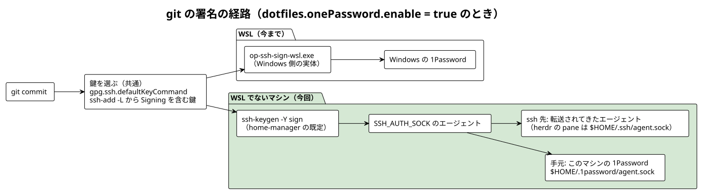
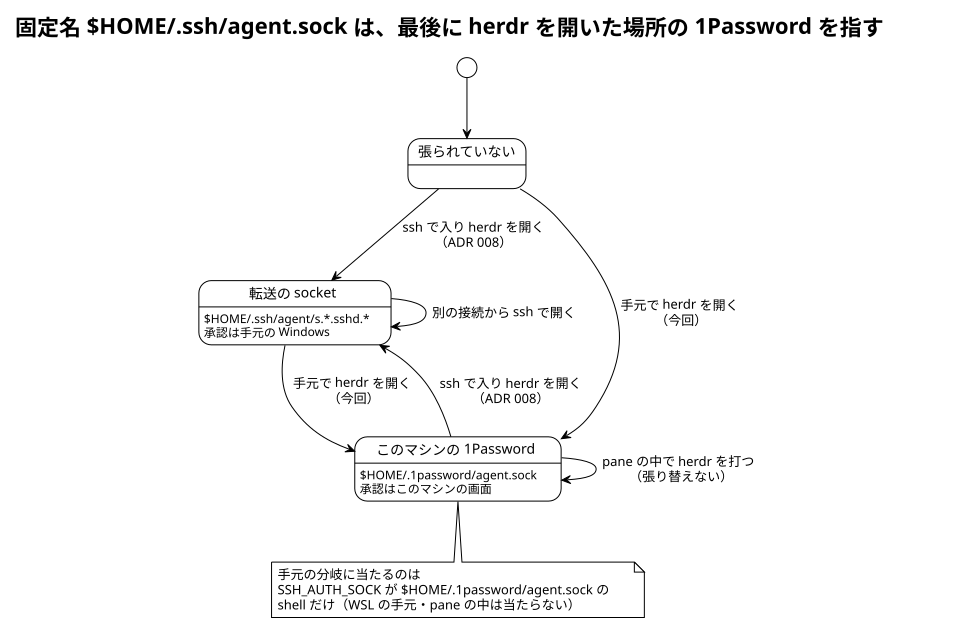

# ADR: 1Password のオプションを WSL の外へ出し、WSL でないマシンでも git の署名に使う。herdr の固定名は手元で開いたときも 1Password へ張り替える

| 項目 | 内容 |
| --- | --- |
| ステータス | 承認 (Accepted) — 方針は 2026-10-18 にユーザーが承認。文面は PR でレビュー |
| 日付 | 2026-10-18 (JST) |
| 決定者 | pollenjp |
| 前提 ADR | [004_nix_wsl_ssh_wrapper](../004_nix_wsl_ssh_wrapper_20260811T124616JST/README.md)（WSL の ssh / ssh-add のラッパー）、[008_ssh_agent_stable_sock](../008_ssh_agent_stable_sock_20260909T144947JST/README.md)（ssh 先で herdr を開くときだけ固定名 `~/.ssh/agent.sock` を張り替える） |
| 関連 (外部) | nixos-config の ADR 009（lavie に 1Password を入れ、手元のセッションの `SSH_AUTH_SOCK` を `~/.1password/agent.sock` にする。ssh で入ったときは転送のまま）、TKT-205 |
| 運用手順 | [`nix/README.md`](../../../nix/README.md)（「マシン登録簿」「git について」「forward された agent を固定名で見せる」） |
| 後続 ADR | [025_herdr_agent_borrow](../025_herdr_agent_borrow_20261020T210555JST/README.md)（`herdr` 関数の手元の分岐（`SSH_AUTH_SOCK` が 1Password なら固定名をそこへ張る）を、herdr を包む実行ファイルと `pjp-agent-link` へ移した。手元の 1Password は持ち主 `local` として同じ規則に載り、socket が無くても張る挙動は変わらない。固定名は session ごとになった。本文の「`herdr` 関数」は決定当時の記録としてそのまま残してある） |

---

## 1. 背景 (Context)

NixOS の laptop（lavie）に 1Password を入れ、SSH の鍵と git の署名にも使うことにした（TKT-205）。
system 側は nixos-config が持ち、GNOME のセッションの `SSH_AUTH_SOCK` を 1Password の SSH エージェント
（`~/.1password/agent.sock`）にする。sshd が立てる shell は user の systemd の環境を継がないので、
WSL から ssh で入ったときは今までどおり転送されてくる Windows の 1Password を使う（nixos-config の ADR 009）。

この dotfiles の 1Password 連携は、WSL 専用として `dotfiles.wsl.onePassword.enable` の下にあった。
options.nix の説明は、WSL 以外で使うときの形を前もって決めていた。

> NOTE: 1Password 連携を WSL 以外 (Linux / macOS ネイティブ) でも使いたく
> なったら、このオプションを dotfiles.wsl の外へ出すこと。今は
> 「1Password を使うのは WSL のときだけ」という前提で入れ子にしている。

### herdr の固定名との関係（2026-10-18 の lavie の実測）

| 項目 | 結果 |
| --- | --- |
| herdr の server | ssh のセッションから起動されており、`SSH_AUTH_SOCK=~/.ssh/agent.sock`（ADR 008 の固定名） |
| GNOME の端末の herdr の client | 同じ server に attach していた。その端末の fish の `SSH_AUTH_SOCK` は、gcr の socket に鍵が無いのでフォールバックが起こした ssh-agent（`~/.ssh/agent/s.*.agent.*`）だった |
| herdr 関数 | 手元（`SSH_CONNECTION` が無い）では何もしない（ADR 008）。lavie の前で herdr を開いても、固定名は最後に ssh で開いた接続の転送を指したまま |

ユーザーは、この herdr の `SSH_AUTH_SOCK` の切り替えと 1Password がぶつからないかを心配した。

## 2. 決定 (Decision)

**1Password のオプションを `dotfiles.onePassword.enable` へ出し、WSL でないマシンでは `ssh-keygen` が
`SSH_AUTH_SOCK` のエージェントで git の署名をする。herdr の固定名は、手元で開いたときも
1Password の socket へ張り替える。**



1. `dotfiles.onePassword.enable`（既定 false）を新設する。`mkHome` の引数 `onePassword` で渡す
   - WSL（`wsl.enable = true`）: 今までどおり。署名は Windows 側の `op-ssh-sign-wsl.exe`、ssh / ssh-add は
     Windows 側の実体へ差し替える（ADR 004）
   - WSL でない: 署名のプログラムは home-manager の既定（openssh の `ssh-keygen`）。ラッパーは置かない
   - 鍵の選び方（`gpg.ssh.defaultKeyCommand`。`ssh-add -L` から名前に "Signing" を含む鍵）は共通
   - 旧名 `dotfiles.wsl.onePassword.enable` は `mkRenamedOptionModule` で新しい名前へ渡し、警告を出す。
     `dotfiles.wsl.onePassword.windowsUserName` は WSL 専用のまま残す
2. 登録簿: `pollenjp@wsl` は新しい名前で有効にし、`pollenjp@laptop` で有効にする
3. bash / fish の 299_ssh_agent（フォールバック）: `SSH_AUTH_SOCK` が `~/.1password/agent.sock` の shell では
   何もしない（ADR 008 の固定名と同じ扱い）
4. bash / fish の `herdr` 関数: `SSH_CONNECTION` が無く、`SSH_AUTH_SOCK` が `~/.1password/agent.sock` なら、
   固定名をそこへ張り（`ln -sfn`。socket がまだ無くても張る）、固定名を渡して起動する

| マシン | 指定 | git の署名 |
| --- | --- | --- |
| 非 WSL / 1Password 無し | 書かない | 署名の設定を書き出さない |
| 非 WSL / 1Password 有り | `onePassword.enable = true` | `ssh-keygen` が `SSH_AUTH_SOCK` のエージェントで署名する |
| WSL / 1Password 無し | `wsl.enable = true` | 署名の設定を書き出さない |
| WSL / 1Password 有り | `wsl = { enable = true; windowsUserName = "…"; }; onePassword.enable = true;` | Windows 側の `op-ssh-sign-wsl.exe` |

固定名は「最後に herdr を開いた場所」の 1Password を指す。



### なぜ署名は `ssh-keygen` か

`ssh-keygen -Y sign` は `SSH_AUTH_SOCK` のエージェントで署名する。lavie の前では 1Password、ssh で入ったときは
転送されてきた Windows の 1Password、herdr の pane では固定名の指す先と、ssh と同じ経路をたどる。
1Password の `op-ssh-sign` も ssh 越しなら転送の socket に切り替わるが、判定に `SSH_TTY` を使うので、
手元で起動した herdr の pane では固定名を無視して手元の 1Password を選ぶ。パスも NixOS では system 側の
固有の場所（`/run/current-system/sw/bin/op-ssh-sign`）になる。

## 3. 変更点の詳細

| ファイル | 変更 |
| --- | --- |
| `nix/home/options.nix` | `dotfiles.onePassword.enable` を新設し、`dotfiles.wsl.onePassword.enable` の宣言を `mkRenamedOptionModule` に置き換えた。先頭の一覧と説明を直した |
| `nix/home/modules/git.nix` | 署名は `onePassword.enable` で丸ごと切り替え、`signer` は WSL のときだけ `op-ssh-sign-wsl.exe`。assertion は「WSL で使うなら windowsUserName が要る」の 1 つにした |
| `nix/home/modules/ssh.nix` | ラッパーは `wsl.enable && onePassword.enable` のときだけ |
| `nix/lib/mk-home.nix` | 引数 `onePassword ? { }` を足し、`dotfiles.onePassword` へ入れる |
| `nix/hosts/default.nix` | `pollenjp@wsl` の `onePassword.enable` を `wsl` の外へ、`pollenjp@laptop` に `onePassword.enable = true` |
| `nix/home/modules/bash.nix` / `fish.nix` | フォールバックの除外と `herdr` 関数の手元の分岐（上の 3・4） |
| `nix/tests/one-password.nix` + `nix/flake.nix` | checks の `one-password-state`（6. 検証） |
| `nix/README.md` / `nix/scripts/setup-local-flake.sh` | 新しい形に合わせた（雛形はコメントの例だけ） |
| `docs/adr/004_…` / `008_…` | 冒頭の表に後続 ADR の行（本文はそのまま） |

```sh
# fish の herdr 関数 (bash も同じ形)
if test -n "$SSH_CONNECTION"
  ssh-agent-link
  SSH_AUTH_SOCK="$HOME/.ssh/agent.sock" command herdr $argv
else if test "$SSH_AUTH_SOCK" = "$HOME/.1password/agent.sock"
  ln -sfn "$HOME/.1password/agent.sock" "$HOME/.ssh/agent.sock"
  SSH_AUTH_SOCK="$HOME/.ssh/agent.sock" command herdr $argv
else
  command herdr $argv
end
```

## 4. 検討した代替案

| 案 | 採らなかった理由 |
| --- | --- |
| B. WSL でないマシンも `op-ssh-sign` で署名する（1Password の公式の勧め） | `SSH_TTY` で手元か ssh 越しかを決めるので、手元で起動した herdr の pane では固定名に従わない。パスが NixOS 固有になる |
| C. `dotfiles.wsl.onePassword.enable` を残し、WSL でないマシン用の別のオプションを足す | 同じことを 2 つの名前で表すことになる。NOTE が決めていた形（外へ出す）を採った |
| D. lavie の 1Password をローカル flake の `local` で有効にする | 登録簿の `pollenjp@laptop` が lavie のための場所で、公開して困る差分でもない。`local` は git 管理外の、マシンだけの差分のため |
| E. herdr 関数は今のまま（手元では張り替えない） | lavie の前で開いた herdr の pane が、最後に ssh で開いた接続の転送を指したままになる（承認が Windows に出るか、接続が閉じていれば鍵が使えない） |
| F. herdr 関数の手元の分岐を、socket が生きているときだけにする | 1Password の socket は場所が決まっているので、アプリが起動する前に張っても後で生きる。生死を確かめると、ログイン直後に開いた herdr が張り替わらない |
| G. `gpg.ssh.allowedSignersFile` を置き、`git log --show-signature` で署名を確かめられるようにする | WSL も置いていない（WSL の生成物を変えない）。今回は見送り、署名の確認は `git cat-file -p HEAD` の `gpgsig` と GitHub の Verified で行う |

## 5. 影響 (Consequences)

### 良くなること

- lavie の前でも ssh 越しでも、同じ "Signing" の鍵で git の commit に署名できる
- lavie の前で開いた herdr の pane が、lavie の 1Password を使う。ssh で入って開き直せば転送に戻る
- 1Password が起動前・ロック中でも、手元の shell が鍵の無いローカル ssh-agent にすり替わらない
- WSL のマシンの生成物（git の設定・ラッパー・warnings）は変わらない

### 注意が必要なこと

- **lavie の home は `--host pollenjp@laptop` で当てる。** ローカル flake がホストを定義していないと、
  `--host` なしの `~/dotfiles/setup` は汎用の `pollenjp@x86_64-linux` を選び、git の署名が入らない
  （フォールバックの除外と herdr 関数は全ホストに入るので効く）
- ローカル flake に旧名 `wsl.onePassword.enable` が残っていると、switch のたびに改名の警告が出る。
  `mkHome` の引数なら `onePassword.enable = true;`、module なら `dotfiles.onePassword.enable = true;` へ移す
- 手元と ssh の両方から同時に attach していると、固定名は後から herdr を開いた方を指す（ADR 008 と同じ）
- `hr`（`herdr --remote`）で attach したときに、lavie 側で fish / bash の `herdr` 関数が走るかは確かめていない。
  走らなければ固定名は張り替わらず、lavie の前で最後に開いていると pane の承認が lavie の画面に出る。
  そのときは ssh で入って `h` で開き直す（ADR 008 の「関数を通さずに起動すると固定名が入らない」と同じ）
- `git log --show-signature` は `gpg.ssh.allowedSignersFile` が無いのでエラーになる（WSL と同じ。4 の G）

## 6. 検証 (Verification)

決定時点で実測済み:

- `nix build ./nix#checks.x86_64-linux.one-password-state`: 14 項目すべて ok（既定・WSL でないマシン・WSL・
  旧名・windowsUserName の assertion・登録簿の 3 ホスト）。変更前は `onePassword` という引数が無くて評価で止まった
- 生成物の比較（変更前と後の `nix eval`）: `pollenjp@wsl` / `pollenjp@wsl-no-1password` /
  `pollenjp@x86_64-linux` の git の設定・ラッパー・warnings は同じ。`pollenjp@laptop` の git の設定にだけ
  `[commit] gpgSign`・`[tag] gpgSign`・`[gpg] format = "ssh"`・`[gpg "ssh"]`（`defaultKeyCommand` と
  openssh の `ssh-keygen`）が増えた
- 挙動（bash と fish の両方）: 描画済みの init と関数を切り出し、偽の `HOME`、python で bind した本物の
  unix socket、stub の `herdr`（受け取った `SSH_AUTH_SOCK` を記録）/ `ssh-add`（socket と鍵の有無で 0 / 1 / 2）/
  `ssh-agent`（呼ばれたことを記録）で回した。変更前は 2・3・6a・6b が両方で外れ（12/20）、変更後は 20/20

| # | 場面 | 期待 |
| --- | --- | --- |
| 1 | ssh で入り herdr を開く | 固定名は転送の socket（今と同じ） |
| 2 | 手元で herdr を開く（1Password の socket が生きている） | 固定名は `~/.1password/agent.sock`、herdr は固定名を受け取る |
| 3 | 手元で herdr を開く（socket がまだ無い） | 2 と同じ |
| 4a / 4b | pane の中で herdr を打つ（手元 / ssh から起動した server） | 固定名は変わらない |
| 5 | WSL の手元（`SSH_AUTH_SOCK` なし） | 固定名を作らない（今と同じ） |
| 6a / 6b | フォールバック、`SSH_AUTH_SOCK` が 1Password（socket なし / 鍵が並ばない） | ssh-agent を起こさず、`SSH_AUTH_SOCK` は変わらない |
| 7 | フォールバック、死んだ別のパス | ssh-agent を起こす（今と同じ） |
| 8 | `ssh -a` の shell（フォールバックのローカル agent）から herdr を開く | 固定名を張らない（今と同じ） |

- 描画済みの `initExtra` を `bash -n`、`interactiveShellInit` と関数の body を `fish --no-execute` で構文検査した
- CI と同じ確認: `nixfmt --check`・shfmt / shellcheck・テストの先頭の「## 確かめること」・`check-test-grep-q.sh`・
  `bootstrap-windows-files.sh --check`・`nix flake check --all-systems --no-build ./nix`・
  `nix flake check --no-eval-cache ./nix`（x86_64-linux。全ホストの activationPackage と checks）・sandbox の
  `warnings` が `[]`。sandbox への activate は CI に任せた（`/tmp/hm-sandbox` に書くため）

未検証（実機。nixos-config の PR を当てたあと）:

- lavie の前で `git commit` が署名つきになる（`git cat-file -p HEAD` の `gpgsig`）。ssh で入ったときは承認が Windows に出る
- lavie の前で herdr を開くと `readlink ~/.ssh/agent.sock` が `~/.1password/agent.sock`、ssh で開き直すと転送の socket
- `hr` で attach したあとの固定名の指す先

## 7. 移行・運用手順

lavie（nixos-config の ADR 009 の switch・再起動・1Password のサインインと設定のあと）:

```sh
~/dotfiles/setup --update --host pollenjp@laptop
git config --get gpg.ssh.program   # …-openssh-…/bin/ssh-keygen
# lavie の前で新しい端末を開き、h / ha で herdr を開き直す
readlink ~/.ssh/agent.sock         # /home/pollenjp/.1password/agent.sock
```

- **新しい端末で開く。** 前からある端末の shell は、フォールバックが起こしたローカル ssh-agent
  （`~/.ssh/agent/s.*.agent.*`）を `SSH_AUTH_SOCK` に持っていることがあり、そのままでは `herdr` 関数の
  手元の分岐に当たらない
- ssh から起動した今の herdr の server は、すでに固定名を持っているので、開き直せば張り替えが効く。
  手元の端末から起動した古い server（固定名を持たない）は、`herdr server stop` してから開き直す

WSL: 何もしなくてよい。ローカル flake に `wsl.onePassword.enable = true;` があれば、改名の警告が出るので
`onePassword.enable = true;`（`mkHome` の引数）へ移す。
