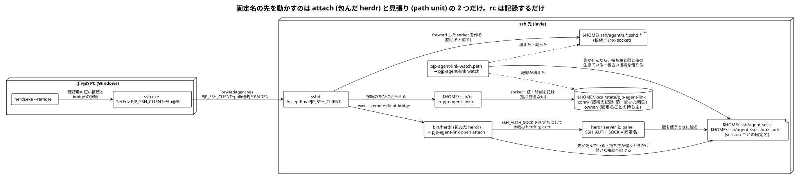

# ADR: herdr の固定名を session ごとに持ち、herdr を包んだ実行ファイル・`~/.ssh/rc`・見張りで、同じマシンから来ている生きている接続を借りる

| 項目 | 内容 |
| --- | --- |
| ステータス | 承認 (Accepted) — 方針は 2026-10-20 にユーザーが承認。文面は PR でレビュー |
| 日付 | 2026-10-20 (JST) |
| 決定者 | pollenjp |
| チケット | [TKT-224](https://app.notion.com/p/herdr-remote-hr-attach-herdr-ssh-agent-ssh-rc-ssh-agent-sock--3fe79149a66f8169b3f9ef9b5fa85819)（集約ハブの会話は [TKT-241](https://app.notion.com/p/herdr-remote-detach-attach-ssh-agent-herdr-ssh-agent-TKT-2-3ff79149a66f815ba94bc798b0000075)） |
| 前提 ADR | [008_ssh_agent_stable_sock](../008_ssh_agent_stable_sock_20260909T144947JST/README.md)（固定名 `~/.ssh/agent.sock` を挟み、ssh 先で herdr を開くときだけ張り替える）、[022_one_password_outside_wsl](../022_one_password_outside_wsl_20261018T105655JST/README.md)（手元で開いたときも、そのマシンの 1Password へ張り替える） |
| 関連 (外部) | nixos-config の TKT-255（全 NixOS ホストの sshd に `AcceptEnv PJP_SSH_CLIENT` を入れる。pollenjp/nixos-config#9） |
| 運用手順 | [`nix/README.md`「forward された agent を固定名で見せる」](../../../nix/README.md#forward-された-agent-を固定名で見せる) |
| 設計 | [`docs/superpowers/specs/2026-10-20-herdr-remote-agent-borrow-design.md`](../../superpowers/specs/2026-10-20-herdr-remote-agent-borrow-design.md)（承認した設計の書き写しと、実装の細部） |

---

## 1. 背景 (Context)

ADR 008 は、ssh 先で herdr を常駐させても ssh を張り直したあとに中から agent が引けるよう、固定名
`~/.ssh/agent.sock` を挟み、fish・bash の `herdr` 関数が「herdr を開いた接続」へ張り替える形にした。

この形は、Windows の `herdr.exe --remote`（hr）で lavie へ繋ぐ今の使い方では効かない。herdr 0.9.1 の source と
lavie・Windows の実測（2026-10-20）で、次のことが分かった。

| 事実 | 出どころ |
| --- | --- |
| hr は ssh 先で `exec /home/pollenjp/.nix-profile/bin/herdr [--session <名前>] remote-client-bridge` を直に打つ。パスはログイン shell の `command -v herdr` で見つけたもので、fish の `exec` は関数を通らない | `src/remote/attach.rs`（`bridge_command_with_idle_timeout`・`remote_binary_on_path_any`） |
| bridge は server が居なければ起こし、server は bridge の env（その接続の forward された socket）を継ぐ。pane は server の env を継ぐ | `src/remote/host.rs`・`src/server/autodetect.rs`・`src/pane.rs` |
| detach で herdr.exe が終わると ssh の接続が閉じ、sshd が socket を消す。pane は agent を失う | lavie の実測（default の server と pane 14 個が、もう無い socket を持っていた） |
| Windows の OpenSSH では herdr は ControlMaster を使わず、attach のたびに bridge の前に確認用の短い接続を何本も張る。どれも agent を forward する | Windows の ssh の設定（`ForwardAgent yes`）と実測 |
| OpenSSH 10.1 からは、forward された socket は `~/.ssh/agent/s.<hash>.sshd.<乱数>` に置かれる | `misc-agent.c` |

ユーザーの依頼（原文は設計の「背景と意図」）は次のとおり。

- detach してから hr で attach し直しても、意識せずに ssh-agent が使えること
- 生きている接続が 1 本でもあれば、それを借りること。ただし切断前の接続が生きていればそれを優先し、借りるのは
  既存の接続で解決できないときだけ
- 借りるのは同じユーザーへ同じマシンから来ている接続に限る（同じユーザーを人と共有したときの誤作動を防ぐ保険）
- 設計の途中で足したこと: 同じマシンは、接続元のアドレスではなく、クライアントが送る環境変数で見分ける。固定名は
  session ごとに分けるが、どれも切断されて生きている接続が 1 本だけなら、全部がそれを指す。`AcceptEnv` の無い
  サーバーでは starship で気づけるようにする

## 2. 決定 (Decision)

**固定名を herdr の session ごとに持ち、server を起こしうる herdr の呼び出しを包んだ実行ファイルが固定名を渡す。
固定名の先は「開いた接続」か「持ち主と同じ値を名乗る、生きている一番古い接続」へ、1 本の script が向け直す。**
ADR 008 の「herdr を開いた接続だけが固定名を動かす（覗くだけの接続は奪わない）」性質は保つ。



### A. session ごとの固定名

| session | 固定名 | 持ち主の記録 |
| --- | --- | --- |
| default | `~/.ssh/agent.sock`（今と同じ） | `~/.local/state/pjp-agent-link/owner/default` |
| ほか（`s2` など） | `~/.ssh/agent.<session>.sock` | `~/.local/state/pjp-agent-link/owner/<session>` |

持ち主は、固定名を張ったときの開いた接続の `PJP_SSH_CLIENT`。attach は開いた session の固定名だけを動かすので、
同じユーザーを共有する人が自分の session を開いても、ほかの session の固定名は動かない。

### B. herdr を包む実行ファイル

home の `bin/herdr`（`~/.nix-profile/bin/herdr`）を、本物の herdr を exec する script にする。hr の bridge もここを通る。

| 呼び出し | すること |
| --- | --- |
| `herdr`（サブコマンドなし）・`herdr session attach <名前>`・`herdr remote-client-bridge [...]` | 向け先を決め直し、`SSH_AUTH_SOCK` をその session の固定名にして exec |
| `herdr server`（headless の server） | 決め直さずに、`SSH_AUTH_SOCK` を固定名にして exec |
| それ以外（`status`・`pane`・`server stop`・`--remote`・`--version` など） | そのまま exec |

herdr 0.9.1 で server を起こすのは `auto_detect_launch` と `ensure_remote_server_running` の 2 か所だけで、
`server live-handoff` は動いている server が新しい server を起こす（server の env を継ぐ）。

### C. 向け先の決め方

| きっかけ | その固定名の今の先 | 決め方 |
| --- | --- | --- |
| herdr を開いた（attach） | 生きていて、持ち主が開いた接続と同じ値 | 変えない（切断前の接続を優先する） |
| herdr を開いた（attach） | 死んでいる・持ち主が分からない・別の値 | 開いた接続へ向け、持ち主をその値にする |
| 接続が増えた・減った（見張り） | 生きている | 何もしない（覗くだけの接続は奪わない） |
| 接続が増えた・減った（見張り） | 死んでいる | 持ち主と同じ値の、生きている接続のうち一番古いものを借りる。無ければ dangling のまま |
| 手で `ssh-agent-link` | 何でも | 今の session の固定名を今の接続へ強制で向ける |

- 「生きている」は `ssh-add -l` が 1 秒以内に 0 か 1 を返すこと（回線断で返事をしない socket で固まらない）。`ssh-add` は
  PATH の system のもの（ssh 先の OpenSSH）を使い、`USE_LINUX_SSH=1` を付ける（WSL の `ssh-add` のラッパーでも、
  `SSH_AUTH_SOCK` を見る Linux の `ssh-add` に落ちる）
- 「一番古い」は rc が記録した開いた時刻。attach の確認用の短い接続より、前からある接続を選ぶため
- 値が届いていない接続は、どの接続とも同じマシンとみなさない（見張りが借りることも、借りられることもない）。
  attach の向け直しは値が空でも効く
- 手元の 1Password（`~/.1password/agent.sock`）は持ち主 `local` として同じ規則に載せ、生死を確かめずに張る（ADR 022）
- 開いた接続として渡さないもの（ADR 008 と同じ）: forward の無い接続（`ssh -a`）・pane の中（`SSH_AUTH_SOCK` が
  固定名）・`SSH_AGENT_PID` のある shell。この場合も ssh 先なら固定名は渡す。pane の中から別の session を
  起こすときは、pane の固定名の先と持ち主を開いた接続として扱う

### D. 接続の記録は `~/.ssh/rc`

sshd が接続のたびに走らせる `~/.ssh/rc` から `pjp-agent-link rc` を呼び、forward された socket・`PJP_SSH_CLIENT`・
開いた時刻を `~/.local/state/pjp-agent-link/conn/<socket の basename>` に書く。**rc は張り替えない**（ADR 008 が
案 C を採らなかった理由の、後勝ちの害を避ける）。stdout は捨てる。X11 の cookie は sshd(8) の例どおり xauth へ渡す。

### E. 見張りは systemd の user の path unit

`pjp-agent-link-watch.path` が `~/.ssh/agent` と `conn/` を `PathChanged` で見て、`pjp-agent-link watch` を起こす。
接続が閉じたときに固定名を向け直せるのはこれだけ。Linux の全ホストに置く（macOS には置かない）。path unit は
service が走っている間の知らせを見ないので、watch は始めと終わりで中身を比べて繰り返す。

### F. 同じマシンは `PJP_SSH_CLIENT` で見分ける

各マシンの ssh が `SetEnv PJP_SSH_CLIENT=%u@%L` で自分のユーザー名とホスト名を送り、受け取る側の sshd が
`AcceptEnv PJP_SSH_CLIENT` で受け取る。`SetEnv` の値の token は OpenSSH 10.0 から展開される。

| 送る側 | 置き場所 | 値の例 |
| --- | --- | --- |
| Windows の ssh.exe（hr・WSL の `ssh`） | `%USERPROFILE%\.ssh\config`（`bootstrap-windows-ssh-config.sh`） | `polle@pjp-raiden`（実機の `ssh.exe -v` で確かめた） |
| `~/.ssh/config` を読む Linux・macOS の ssh | `~/.ssh/config`（`programs.ssh.settings."*"`） | OpenSSH 10.0 以上なら `<ユーザー>@<ホスト>`（WSL の nix の OpenSSH 10.5 なら `pollenjp@pjp-raiden`）。WSL の `/usr/bin/ssh`（9.6p1）は `%u@%L` のまま送るので届いていない扱い |

- 空・`%` を含む（10.0 より古い ssh は `%u@%L` のまま送る。みな同じ文字列になるので、そのままでは別のマシン同士が
  同じに見える）・制御文字を含む・`local` の値は、届いていないものとして扱う
- 大文字小文字は揃えない。同じ PC でも ssh.exe と WSL の Linux の ssh はユーザー名から違うので、別のマシンになる
- なりすましは防がない（誤作動を防ぐ保険）

### G. 値が届いていないことを starship で出す

ssh で入った shell（herdr の外）で値が空なら、herdr の pane では固定名の持ち主が空なら、プロンプトに
`⚠ PJP_SSH_CLIENT なし` を出す。pane の env には server を起こした接続の値が残るので、env ではなく持ち主の記録を見る。
判定は `sh` で、外のコマンドも `ssh-add` も呼ばない。

### H. 張り替えの排他

決め直しは、`ssh-add` で生死を見る間は lock を持たず、入れ替える直前に `flock`（PATH の util-linux のもの。無いホストでは
取らない。macOS は見張りが無いので、守っていた同時の書き込みが起きない）を取って「決めたときの先と持ち主の
まま」かを見てから、一時名の symlink を rename で入れ替える（固定名が消える瞬間を作らない）。変わっていたら決め直す。
見張りが、別のマシンから開き直された直後の固定名を、古い見立てで前の持ち主の接続へ戻さないため。

持ち主は固定名を入れ替えたあとに書き、記録には張った先も添える（「値」と「張った先」の 2 行）。張った先が今の固定名の先と
違う記録は「持ち主が分からない」として扱う。入れ替えの途中で失敗しても（書けない・時間切れで止められた）「新しい持ち主と
古い先」の組は残らず、別のマシンの agent を同じマシンのものと取り違えない。

### I. shell の関数を消す

fish・bash の `herdr` 関数と `ssh-agent-link` 関数は消す（同じことを shell ごとに 2 回書かない。関数を通らない hr の
経路と挙動が分かれない）。`ssh-agent-link` は同じ名前のコマンドになる。init の `299_ssh_agent` は残し、「固定名」の
判定を `~/.ssh/agent.<session>.sock` にも広げる（pane ではローカル agent へ倒れない）。

## 3. 変更点の詳細

| ファイル | 変更 |
| --- | --- |
| `nix/pkgs/pjp-agent-link/pjp-agent-link.sh`・`default.nix` | 向け先を決める script（`open`・`watch`・`link`・`rc`・`status`）と `ssh-agent-link`。runtimeInputs は coreutils だけで、`ssh-add` と `flock` は PATH の system のもの（openssh と flock を home の閉包に入れると、閉包の脆弱性スキャンが openssh の CVE と、名前の一致する別の製品の CVE を拾った。CI で実測） |
| `nix/pkgs/pjp-agent-link/herdr.sh`・`herdr.nix` | herdr を包む実行ファイル。`bin/herdr` だけを替え、補完と skill は本物の herdr の symlink |
| `nix/home/modules/agent-link.nix`（新設） | 包んだ herdr・`pjp-agent-link`・`~/.ssh/rc`・見張りの unit |
| `nix/home/modules/packages.nix` | `herdr` を外した（agent-link.nix が入れる） |
| `nix/home/modules/fish.nix`・`bash.nix` | `herdr`・`ssh-agent-link` の関数を消し、`299_ssh_agent` の判定を広げた |
| `nix/home/modules/ssh.nix` | `Host *` に `SetEnv PJP_SSH_CLIENT="%u@%L"` |
| `nix/scripts/bootstrap-windows-ssh-config.sh` | Windows の `config` に `Host *` と `SetEnv PJP_SSH_CLIENT=%u@%L` |
| `nix/files/starship.toml` | `[custom.pjp_ssh_client]` |
| `nix/home/modules/claude.nix`・`nix/tests/claude-herdr-skill.nix` | skill は包む前の herdr から張る（コメントとテストを合わせた） |
| `nix/tests/pjp-agent-link.test.sh`・`nix/tests/agent-link.nix` + `nix/flake.nix` | checks の `pjp-agent-link-test`・`agent-link-state` |
| （branch のレビューで足したもの） | 張り替えの順と失敗の止め方・持ち主の記録の張った先・rc の開いた時刻の引き継ぎ・herdr.sh の端の引数・status の PATH の herdr。テストの足りなかった所（開いた順・stdin と stderr の守り・空の持ち主・rc の stdout）も足した |
| `nix/tests/bootstrap-windows-ssh-config.test.sh` | 新しい `config` の中身と、前の版からの上書き |
| `nix/README.md`・`win/README.md` | 運用手順 |
| `docs/adr/008_…`・`022_…` | 冒頭の表に後続 ADR の行（本文はそのまま） |

## 4. 検討した代替案

| 案 | 採らなかった理由 |
| --- | --- |
| ADR 008 の案 C そのまま（`~/.ssh/rc` が接続のたびに固定名を張り替える） | 後勝ちになる。覗くだけの接続や attach の確認用の短い接続が固定名を奪い、閉じると herdr の中の全員が agent を失う。rc は記録だけにした |
| 同じマシンを接続元のアドレスで見分ける（cc-page 0001 の形） | DHCP でアドレスが変わる・IPv4 と IPv6 で違う・NAT や踏み台の越しでは別の PC が同じアドレスになる。ユーザーが環境変数で見分ける形を選んだ |
| 名前を `LC_PJP_SSH_CLIENT` にする（Debian・Ubuntu・macOS の sshd は既定で `AcceptEnv LANG LC_*` を持つので、設定なしで届く） | Debian の ssh の既定の `SendEnv LANG LC_*` で、そこからさらに ssh した先へも値が付いて行き、別のマシンからの接続が元の PC を名乗ってしまう。locale の名前の場所を借りる形にもなる |
| 固定名を 1 つにする（cc-page 0002 の形） | ある session の attach が、ほかの session の固定名を動かす。同じユーザーを共有したときの保険が弱い。ユーザーが session ごとを選んだ |
| 見張りを常駐の `inotifywait -m` にする | 依存と常駐のプロセスが増える。path unit の取りこぼしは、watch が始めと終わりで比べて繰り返すことで小さくでき、残る短い間に起きたものも次の知らせ（次の接続・attach）で直る |
| lock を使わず rename だけで入れ替える | 見張りが `ssh-add` で生死を見ている間に別のマシンから開き直されると、見張りが古い見立てで前の持ち主の接続へ戻す |
| fish・bash の `herdr` 関数を薄く残す | 関数を通る経路と通らない経路（hr）で挙動が分かれたままになる |
| herdr 側で attach のときに env を更新する（tmux の `update-environment` 相当） | ADR 008 の案 E と同じ。すでに走っている pane には効かず、herdr は手を入れる対象ではない |

## 5. 影響 (Consequences)

### 良くなること

- hr で detach → attach し直しても、pane から agent が使える（attach が開いた接続へ向け直す）
- detach したままでも、同じ PC から素の ssh の端末などが繋がっていれば、見張りがその接続を借りる。default と s2 の
  どちらも切断され、生きている接続が 1 本なら、両方がそれを指す
- 覗くだけの接続と attach の確認用の短い接続は、固定名の先が生きている限り奪わない
- 別のマシン（値の違う・届いていない接続）の agent を、見張りが勝手に借りない
- `PJP_SSH_CLIENT` が届いていないサーバーに、プロンプトで気づける
- WSL の手元と、lavie の前で開いたときの挙動（ADR 022）は変わらない

### 注意が必要なこと

- **今動いている server は、作り直すまで今のまま。** 適用したあと、都合のよいときに 1 回 `herdr server stop`
  （named session は `herdr session stop <名前>`）して開き直す。pane のプロセスは終わる（Claude Code は herdr の
  agent session restore で会話へ戻れる）
- **借りる仕組みは、受け取る側の sshd が `AcceptEnv PJP_SSH_CLIENT` を持つときだけ効く。** 無いサーバーでは借りない
  だけで、attach し直せば鍵は使える。NixOS のホストは nixos-config が入れる（TKT-255）。ほかは警告を見て都度足す
- ssh は最初に当たった `SetEnv` の行だけを使う。`config.d` の `Host` に自分の `SetEnv` がある接続先では、そこにも
  `PJP_SSH_CLIENT=%u@%L` を足さないと届かない
- `~/.ssh/rc` を置くと、sshd は xauth を自分では呼ばず（rc が渡す）、`/etc/ssh/sshrc` も走らせない。sftp・
  ForceCommand・`PermitUserRC no`・authorized_keys の `restrict` / `no-user-rc` の接続では rc が走らず、その接続は
  見張りに借りられない。手で置いた `~/.ssh/rc` があるマシンでは、switch が「would be clobbered」で止まる
- 見張りの service は起動の上限を外してある（`StartLimitIntervalSec = 0`）。既定の上限（10 秒に 5 回）では、hr の attach
  のように接続が続くと上限に当たり、path unit ごと failed になって見張りが止まった（lavie の実機で見つけた）
- path unit が service を走らせている間に起きた変化は、watch の最後の比べから unit が見張りに戻るまでのごく短い間に
  起きたものだけ取りこぼす（次の接続か attach で直る）
- OpenSSH 10.1 より古いホスト（socket が `/tmp/ssh-*/`）は見張らない。macOS は見張りが無い（attach の張り替えだけ）
- user の systemd が止まっている間（linger の無いホストで最後の session が閉じたあと）は見張りも止まる。次に繋いだ
  接続の attach で直る
- 削除した session の固定名と持ち主の記録は残る（使うプロセスが無いので害は無い。要らなければ消してよい）
- **ssh 先の PATH で、包んでいない herdr が先に見つかると固定名は渡らない。** herdr.exe は remote の herdr と版が合わないとき、
  `~/.local/bin/herdr` へ入れることを提案する（既定は Yes）。`~/.local/bin` は `~/.nix-profile/bin` より前にあるので、承認すると
  hr の bridge は包んでいない herdr を打つ。`pjp-agent-link status` の最後の行で、PATH の herdr が包んだものかを見られる
- `~/.ssh/rc` は X11 の cookie を PATH の `xauth` へ渡す（sshd の `XAuthLocation` は使えない）。X11 forwarding を使うホストで
  `xauth` が PATH に無いと、X11 の認証が入らない（stderr に 1 行出る）。lavie は X11Forwarding no
- `Host *` の `SetEnv` は、`AcceptEnv` の無いサーバー（GitHub など）にも `user@host` を送る（相手は捨てるが、届きはする）
- 誰も繋いでいないあいだは、herdr の中から鍵は使えない（ADR 008 と同じ、意図した性質）

## 6. 検証 (Verification)

nix の check（CI と同じ）:

- `nix build ./nix#checks.x86_64-linux.pjp-agent-link-test`: 偽の HOME・偽の `ssh-add`・python で bind した本物の unix
  socket で、attach の表・「開いた接続」の決め方・link・rc（stdout が空・xauth・記録）・watch（cc-page 0003 の場面 1 の
  1〜11、覗くだけの接続、返事をしない記録、見張りと attach が同時に走る場面）・status・包む実行ファイル（attach と
  みなす呼び出し・何もしない呼び出し・bridge の stdin と stdout・失敗と時間切れ）・starship の判定（本物の starship も）を流す
- `nix build ./nix#checks.x86_64-linux.agent-link-state`: home の中身（包んだ herdr・rc・unit・関数が無いこと・
  フォールバックの判定・`SetEnv`）と、包んだ herdr が本物の herdr を store のパスで exec すること
- `bootstrap-windows-ssh-config-test`・`claude-herdr-skill`・`nix flake check --all-systems --no-build`・
  `nix flake check --no-eval-cache`・shfmt・shellcheck・nixfmt・テストの先頭の「## 確かめること」・`check-test-grep-q.sh`

### 6.1 lavie での実機（2026-10-20）

branch の home を、ローカル flake の `dotfiles` 入力を `--override-input` で一時の clone に替え、`--no-write-lock-file` で
`pollenjp@laptop` に当てた（ローカル flake と lock は書き換えていない。終わったあと main の home に戻した）。値が届かない
場面は lavie の sshd（port 22。`AcceptEnv` 無し）、値が届く場面はユーザー権限の一時の sshd（127.0.0.1:2224、
`AcceptEnv PJP_SSH_CLIENT`）に、Windows の試験用の Host（ProxyJump）から入った。hr は Windows の `herdr.exe`
（0.9.2-preview）で、試験用の session（`tkt224n`・`tkt224a`・`tkt224b`）だけを使った。

| # | 場面 | 結果 |
| --- | --- | --- |
| 1 | hr で attach → detach → attach（port 22） | 1 回目の attach で server が `SSH_AUTH_SOCK=~/.ssh/agent.tkt224n.sock` で起き、固定名は bridge の接続を指した。detach で dangling になり、pane の `ssh-add -l` は rc=2。attach し直すと、同じ server のまま新しい接続へ張り替わり、pane の `ssh-add -l` が鍵を返した |
| 2 | 同じ PC の 2 つの session の片方を閉じる | `tkt224a` を detach すると、見張りが同じ PC からの生きている一番古い接続（素の ssh の端末 C）を借りた。`tkt224b` は動かない |
| 3 | 両方の session を閉じ、素の ssh の端末だけ | 両方の固定名が C を指した。detach したままの `tkt224a` の pane の `ssh-add -l` が鍵を返した |
| 4 | 覗くだけの ssh を開いて閉じる | 固定名の先は変わらない |
| 5 | 返事をしない socket（sshd-session を `kill -STOP`）を指す状態で attach | attach は bridge の記録の 1 秒後に見切って移った（hr の画面は 4 秒で出た）。見張りも 1.1 秒で見切って、ほかの固定名に生きている接続を借りた |
| 6 | 別の値（`taro@LAPTOP-TEST`）の接続から開く | 開いた session の固定名だけが移り、持ち主も移った。ほかの session は動かない |
| 7 | 別の値の接続だけが生きているときに先が死ぬ | 借りない（dangling） |
| 8 | 値が届かない接続（port 22） | 持ち主は空のまま借りない。pane と ssh の shell のプロンプトに `⚠ PJP_SSH_CLIENT なし`（値が届く shell には出ない） |
| 9 | lavie の前で開く | env を作って `pjp-agent-link open attach` で確かめた。1Password の socket が無くても `~/.1password/agent.sock` へ張り、持ち主は `local` |
| 10 | WSL の手元 | この PC で build した package で、`open attach` は何も出さず、固定名も記録の場所も作らない |
| 11 | 誰も繋いでいない | pane の `ssh-add -l` は rc=2（ローカルの鍵へ倒れない） |

- cc-page 0003 の場面 1 の 7〜11 も通った: C が生きていれば開き直しても C のまま（7）、C を閉じると両方の固定名が
  開き直した接続 D を借りる（8）、別のマシンから開いて閉じると、その session は同じ値の接続を借り、持ち主が PC の
  session は借りない（10・11）。attach の途中で、dangling の固定名が確認用の短い接続を一瞬借り、bridge の接続へ移る
  動きも見えた（cc-page 0002 の場面 2）
- 署名: 何度も detach と attach を繰り返した `tkt224a`（server は作り直していない）の pane で `ssh-keygen -Y sign` を
  1 回打ち、Windows の 1Password の承認 1 回で、`1pass SSH Key` の署名ができた（`ssh-keygen -Y check-novalidate` で Good）
- 値: Windows の ssh.exe は `setting env PJP_SSH_CLIENT = "polle@pjp-raiden"` を送った（`ssh.exe -v`）。ホスト名は小文字
- 見張りが止まる不具合を見つけて直した: 接続が続くと service が systemd の起動の上限（10 秒に 5 回）に当たり、
  `unit-start-limit-hit` で path unit ごと failed になった。上限を外したあと、8 本続けて開いて閉じても止まらず、閉じた
  接続の記録が消えることを確かめた
- 確かめの途中から、試験の接続は Windows の鍵ファイル（`IdentitiesOnly`）で認証し、1Password へ署名を求めるのは上の
  署名の 1 回だけにした（はじめは 1Password の鍵で認証していて、承認の要求を 90 回ほど出してしまった）

#### 最後の build（500467f）での流し直し（2026-10-20 23:37〜23:40）

上の表を流したのは 3e50a19 の build で、そのあとレビューの直しと、`ssh-add`・`flock` を PATH の system のものにする直しを
入れた。最後の build で場面 1 と 3 を流し直した。試験の接続はすべて Windows の鍵ファイル（`IdentitiesOnly`）で認証し、
1Password へは署名を求めていない（pane の確かめは `ssh-add -l` だけ）。

| 場面 | 結果 |
| --- | --- |
| 1（port 22・値なし） | attach で server が固定名で起き、pane の `ssh-add -l` が鍵を返した。detach で dangling・rc=2。attach し直すと新しい接続へ張り替わり、同じ server（pid は変わらない）の pane で鍵を返した |
| 3（一時の sshd・値あり） | 2 つの session と素の ssh の端末 C を開いた。1 つ目を detach すると見張りが 2 つ目の bridge（同じ PC の生きている一番古い接続）を借り、2 つ目も detach すると両方の固定名が C を指し、両方の pane の `ssh-add -l` が鍵を返した |
| 見張り | 流している間に service は 63 回正常に終わり、失敗・起動の上限・not found の行は 0。service と同じ systemd の user の環境で `ssh-add` は `/run/current-system/sw/bin/ssh-add`（OpenSSH 10.5p1）、`flock` は `/run/current-system/sw/bin/flock`（util-linux 2.42.3）に解決され、`pjp-agent-link` の閉包に openssh と flock は無い |

終わったあと main の home（世代 16。世代 11 と同じ store path）に戻し、試験のために足したもの（一時の sshd・試験用の
Host のファイルと known_hosts・試験用の session・固定名と記録の場所・一時の clone）を全部消した。

## 7. 移行・運用手順

```sh
# 1. 適用 (lavie なら --host pollenjp@laptop)。WSL のマシンでは Windows の config の SetEnv も配られる
~/dotfiles/setup --update

# 2. 今動いている server を 1 回作り直す (固定名を持たずに起きた server のため)
herdr server stop          # default
herdr session stop s2      # named session ごとに
# Windows の PowerShell から開き直す (bridge が包んだ herdr を通り、固定名を持つ server が起きる)
herdr.exe --remote lavie.local

# 3. 確かめる (ssh 先で)
pjp-agent-link status      # 固定名の先・生死・持ち主と、記録にある接続
# herdr の pane の中で
echo "$SSH_AUTH_SOCK"      # ~/.ssh/agent.sock (named session は ~/.ssh/agent.<名前>.sock)
ssh-add -l                 # 鍵が並ぶ
```

- ssh 先の sshd に `AcceptEnv PJP_SSH_CLIENT` が無いと、プロンプトに `⚠ PJP_SSH_CLIENT なし` が出る（借りる仕組みが
  効かないだけで、attach し直せば鍵は使える）
- 鍵が引けなくなったら、detach して開き直すか、herdr の外の ssh の shell で `ssh-agent-link` を打つ
- 張り替えの記録は `~/.local/state/pjp-agent-link/log`
