```mermaid
flowchart LR
  g["グループ: client<br/>ホストで選んだ"]
  t1["① エンジニアの道具<br/>on<br/>どのグループでも"]
  t2["② AI の道具<br/>off<br/>グループの既定"]
  t3["③ 個人のアカウント<br/>off<br/>グループの既定"]
  g --> t1
  g --> t2
  g --> t3
  wsl["WSL の手当て<br/>on<br/>ホストで決めた"]
  windowsFiles["Windows のアプリと設定 (win/)<br/>on<br/>ホストで決めた"]
  windowsTypeClipboard["Windows の type-clipboard<br/>off"]
  exeExecTrace[".exe の起動の記録 (WSL)<br/>off"]
  mtuGuard["eth0 の MTU の見張り (WSL)<br/>off"]
  osCaBundle["証明書の束を OS の信頼ストアに寄せる<br/>on"]
  cleanup["使わない store path・mise の版の掃除<br/>on"]
  claude["Claude Code 一式<br/>off"]
  herdr["herdr<br/>off"]
  herdrCore["herdr-core (hc)<br/>off"]
  windowsClaudeCode["Windows の Claude Code<br/>off"]
  windowsHerdr["Windows の herdr・herdr-app<br/>off"]
  cursorAgent["cursor-agent<br/>off"]
  claudePrivateSkills["private な skill (claude-skills の clone)<br/>off"]
  ccPages["cc-pages<br/>off"]
  herdrHub["集約ハブ ~/h<br/>off"]
  windowsClaudeAccounts["Windows の claude-personal・claude-work<br/>off"]
  devTracker["Notion Dev Tracker<br/>off"]
  devTrackerInbox["Dev Tracker の見回り役<br/>off"]
  onePassword["1Password<br/>off"]
  opReasonSshRelay["op-reason の SSH の中継<br/>off"]
  ntn["ntn (Notion の CLI)<br/>off"]
  windowsNtn["Windows の ntn<br/>off"]
  windowsTailscale["Windows の Tailscale<br/>off"]
  windowsSshd["Windows の sshd (Tailscale から鍵で入る)<br/>off"]
  gitIdentity["git の名前とメール (pollenjp・pollenjp-sub)<br/>off"]
  t1 --> wsl
  t1 --> windowsFiles
  t1 --> windowsTypeClipboard
  t1 --> exeExecTrace
  t1 --> mtuGuard
  t1 --> osCaBundle
  t1 --> cleanup
  t2 --> claude
  t2 --> herdr
  t2 --> herdrCore
  t2 --> windowsClaudeCode
  t2 --> windowsHerdr
  t2 --> cursorAgent
  t2 --> claudePrivateSkills
  t3 --> claudePrivateSkills
  t2 --> ccPages
  t3 --> ccPages
  t2 --> herdrHub
  t3 --> herdrHub
  t2 --> windowsClaudeAccounts
  t3 --> windowsClaudeAccounts
  t2 --> devTracker
  t3 --> devTracker
  t2 --> devTrackerInbox
  t3 --> devTrackerInbox
  t3 --> onePassword
  t3 --> opReasonSshRelay
  t3 --> ntn
  t3 --> windowsNtn
  t3 --> windowsTailscale
  t3 --> windowsSshd
  t3 --> gitIdentity
  classDef on fill:#e6f4ea,stroke:#34a853,color:#0d652d
  classDef off fill:#f1f3f4,stroke:#9aa0a6,color:#5f6368
  classDef na fill:#ffffff,stroke:#bdc1c6,color:#9aa0a6,stroke-dasharray:4 3
  classDef onHost fill:#e6f4ea,stroke:#d93025,stroke-width:3px,color:#0d652d
  classDef offHost fill:#f1f3f4,stroke:#d93025,stroke-width:3px,color:#5f6368
  classDef naHost fill:#ffffff,stroke:#d93025,stroke-width:3px,color:#9aa0a6,stroke-dasharray:4 3
  class t1,osCaBundle,cleanup on
  class t2,t3,windowsTypeClipboard,exeExecTrace,mtuGuard,claude,herdr,herdrCore,windowsClaudeCode,windowsHerdr,cursorAgent,claudePrivateSkills,ccPages,herdrHub,windowsClaudeAccounts,devTracker,devTrackerInbox,onePassword,opReasonSshRelay,ntn,windowsNtn,windowsTailscale,windowsSshd,gitIdentity off
  class wsl,windowsFiles onHost
```

```mermaid
flowchart LR
  g["グループ: client<br/>ホストで選んだ"]
  t1["① エンジニアの道具<br/>on<br/>どのグループでも"]
  t2["② AI の道具<br/>off<br/>グループの既定"]
  t3["③ 個人のアカウント<br/>off<br/>グループの既定"]
  g --> t1
  g --> t2
  g --> t3
  wsl["WSL の手当て<br/>on<br/>ホストで決めた"]
  windowsFiles["Windows のアプリと設定 (win/)<br/>on<br/>ホストで決めた"]
  windowsTypeClipboard["Windows の type-clipboard<br/>off"]
  exeExecTrace[".exe の起動の記録 (WSL)<br/>off"]
  mtuGuard["eth0 の MTU の見張り (WSL)<br/>off"]
  osCaBundle["証明書の束を OS の信頼ストアに寄せる<br/>on"]
  cleanup["使わない store path・mise の版の掃除<br/>on"]
  claude["Claude Code 一式<br/>on<br/>ホストで決めた"]
  herdr["herdr<br/>off"]
  herdrCore["herdr-core (hc)<br/>off"]
  windowsClaudeCode["Windows の Claude Code<br/>off"]
  windowsHerdr["Windows の herdr・herdr-app<br/>off"]
  cursorAgent["cursor-agent<br/>off"]
  claudePrivateSkills["private な skill (claude-skills の clone)<br/>off"]
  ccPages["cc-pages<br/>off"]
  herdrHub["集約ハブ ~/h<br/>off"]
  windowsClaudeAccounts["Windows の claude-personal・claude-work<br/>off"]
  devTracker["Notion Dev Tracker<br/>off"]
  devTrackerInbox["Dev Tracker の見回り役<br/>off"]
  onePassword["1Password<br/>off"]
  opReasonSshRelay["op-reason の SSH の中継<br/>off"]
  ntn["ntn (Notion の CLI)<br/>off"]
  windowsNtn["Windows の ntn<br/>off"]
  windowsTailscale["Windows の Tailscale<br/>off"]
  windowsSshd["Windows の sshd (Tailscale から鍵で入る)<br/>off"]
  gitIdentity["git の名前とメール (pollenjp・pollenjp-sub)<br/>off"]
  t1 --> wsl
  t1 --> windowsFiles
  t1 --> windowsTypeClipboard
  t1 --> exeExecTrace
  t1 --> mtuGuard
  t1 --> osCaBundle
  t1 --> cleanup
  t2 --> claude
  t2 --> herdr
  t2 --> herdrCore
  t2 --> windowsClaudeCode
  t2 --> windowsHerdr
  t2 --> cursorAgent
  t2 --> claudePrivateSkills
  t3 --> claudePrivateSkills
  t2 --> ccPages
  t3 --> ccPages
  t2 --> herdrHub
  t3 --> herdrHub
  t2 --> windowsClaudeAccounts
  t3 --> windowsClaudeAccounts
  t2 --> devTracker
  t3 --> devTracker
  t2 --> devTrackerInbox
  t3 --> devTrackerInbox
  t3 --> onePassword
  t3 --> opReasonSshRelay
  t3 --> ntn
  t3 --> windowsNtn
  t3 --> windowsTailscale
  t3 --> windowsSshd
  t3 --> gitIdentity
  classDef on fill:#e6f4ea,stroke:#34a853,color:#0d652d
  classDef off fill:#f1f3f4,stroke:#9aa0a6,color:#5f6368
  classDef na fill:#ffffff,stroke:#bdc1c6,color:#9aa0a6,stroke-dasharray:4 3
  classDef onHost fill:#e6f4ea,stroke:#d93025,stroke-width:3px,color:#0d652d
  classDef offHost fill:#f1f3f4,stroke:#d93025,stroke-width:3px,color:#5f6368
  classDef naHost fill:#ffffff,stroke:#d93025,stroke-width:3px,color:#9aa0a6,stroke-dasharray:4 3
  class t1,osCaBundle,cleanup on
  class t2,t3,windowsTypeClipboard,exeExecTrace,mtuGuard,herdr,herdrCore,windowsClaudeCode,windowsHerdr,cursorAgent,claudePrivateSkills,ccPages,herdrHub,windowsClaudeAccounts,devTracker,devTrackerInbox,onePassword,opReasonSshRelay,ntn,windowsNtn,windowsTailscale,windowsSshd,gitIdentity off
  class wsl,windowsFiles,claude onHost
```

<!-- 生成物 (dotfiles の nix/lib/host-summary.nix)。手で直さない -->

> 生成物。手で直さない。出し直すのは dotfiles の root で `nix eval --raw ./nix#lib.groupsDoc > nix/groups.md`。古ければ CI (flake の checks の groups-doc) が落ちる。

# 設定グループ

ホストは設定グループを 1 つ選び (`mkHome` の `group`)、グループは「どの段の道具まで入れるか」で決まる (dotfiles-private の ADR 057)。選び方・直し方・setup の振る舞いは [README の「設定グループ」](./README.md#設定グループ)。ここは `nix/lib/groups.nix` の表と、作り物のホストの要約から作った生成物。

## グループ

| グループ | 使う PC と何を入れるか | ① エンジニアの道具 | ② AI の道具 | ③ 個人のアカウント |
| --- | --- | --- | --- | --- |
| `personal` | 個人の開発用の PC。① ② ③ を全部入れる (グループを選ばないホストもこれ) | on | on | on |
| `company` | 自社の PC。① と ② を入れ、③ は要るものだけをホストで足す | on | on | off |
| `client` | 客先の PC。① だけを入れ、許可の出た道具をホストで 1 つずつ足す | on | off | off |

## 道具の switch と、グループごとの既定

グループだけを書いた (ほかの値を書かない) ホストの値。Windows の道具は `wsl.windowsFiles.enable` のマシンでだけ効く (効く条件の列)。既定が段によらない道具 (`onePassword.enable` など) は、どのグループでも off で、使うホストが入れる。

| 段 | 道具 | option (`dotfiles.…`) | `personal` | `company` | `client` | 効く条件 |
| --- | --- | --- | --- | --- | --- | --- |
| ① | WSL の手当て | `wsl.enable` | off | off | off |  |
| ① | Windows のアプリと設定 (win/) | `wsl.windowsFiles.enable` | off | off | off |  |
| ① | Windows の type-clipboard | `wsl.windowsFiles.typeClipboard.enable` | off | off | off | `wsl.windowsFiles.enable` |
| ① | .exe の起動の記録 (WSL) | `wsl.exeExecTrace.enable` | off | off | off |  |
| ① | eth0 の MTU の見張り (WSL) | `wsl.mtuGuard.enable` | off | off | off |  |
| ① | 証明書の束を OS の信頼ストアに寄せる | `osCaBundle.enable` | on | on | on |  |
| ① | 使わない store path・mise の版の掃除 | `cleanup.enable` | on | on | on |  |
| ② | Claude Code 一式 | `claude.enable` | on | on | off |  |
| ② | herdr | `herdr.enable` | on | on | off |  |
| ② | herdr-core (hc) | `herdrCore.enable` | on | on | off |  |
| ② | Windows の Claude Code | `wsl.windowsFiles.claudeCode.enable` | on | on | off | `wsl.windowsFiles.enable` |
| ② | Windows の herdr・herdr-app | `wsl.windowsFiles.herdr.enable` | on | on | off | `wsl.windowsFiles.enable` |
| ② | cursor-agent | `cursorAgent.enable` | off | off | off |  |
| ②③ | private な skill (claude-skills の clone) | `claude.privateSkills.enable` | on | off | off |  |
| ②③ | cc-pages | `ccPages.enable` | on | off | off |  |
| ②③ | 集約ハブ ~/h | `herdr.hub.enable` | on | off | off |  |
| ②③ | Windows の claude-personal・claude-work | `wsl.windowsFiles.claudeAccounts.enable` | on | off | off | `wsl.windowsFiles.enable`・`wsl.windowsFiles.claudeCode.enable` |
| ②③ | Notion Dev Tracker | `claude.devTracker.enable` | off | off | off |  |
| ②③ | Dev Tracker の見回り役 | `claude.devTracker.inbox.enable` | off | off | off |  |
| ③ | 1Password | `onePassword.enable` | off | off | off |  |
| ③ | op-reason の SSH の中継 | `opReason.sshRelay.enable` | off | off | off | `onePassword.enable` |
| ③ | ntn (Notion の CLI) | `ntn.enable` | on | off | off |  |
| ③ | Windows の ntn | `wsl.windowsFiles.ntn.enable` | on | off | off | `wsl.windowsFiles.enable` |
| ③ | Windows の Tailscale | `wsl.windowsFiles.tailscale.enable` | off | off | off | `wsl.windowsFiles.enable` |
| ③ | Windows の sshd (Tailscale から鍵で入る) | `wsl.windowsFiles.sshd.enable` | off | off | off | `wsl.windowsFiles.enable` |
| ③ | git の名前とメール (pollenjp・pollenjp-sub) | `git.identity.enable` | on | off | off |  |

## 作り物のホストの要約

`nix/lib/group-examples.nix` のホスト (どれも WSL で `win/` を配る。値は作り物)。

### personal (個人の PC。グループの既定のまま)

グループ: **personal** (ホストで選んだ) · ① on · ② on · ③ on

```mermaid
flowchart LR
  g["グループ: personal<br/>ホストで選んだ"]
  t1["① エンジニアの道具<br/>on<br/>どのグループでも"]
  t2["② AI の道具<br/>on<br/>グループの既定"]
  t3["③ 個人のアカウント<br/>on<br/>グループの既定"]
  g --> t1
  g --> t2
  g --> t3
  wsl["WSL の手当て<br/>on<br/>ホストで決めた"]
  windowsFiles["Windows のアプリと設定 (win/)<br/>on<br/>ホストで決めた"]
  windowsTypeClipboard["Windows の type-clipboard<br/>off"]
  exeExecTrace[".exe の起動の記録 (WSL)<br/>off"]
  mtuGuard["eth0 の MTU の見張り (WSL)<br/>off"]
  osCaBundle["証明書の束を OS の信頼ストアに寄せる<br/>on"]
  cleanup["使わない store path・mise の版の掃除<br/>on"]
  claude["Claude Code 一式<br/>on"]
  herdr["herdr<br/>on"]
  herdrCore["herdr-core (hc)<br/>on"]
  windowsClaudeCode["Windows の Claude Code<br/>on"]
  windowsHerdr["Windows の herdr・herdr-app<br/>on"]
  cursorAgent["cursor-agent<br/>off"]
  claudePrivateSkills["private な skill (claude-skills の clone)<br/>on"]
  ccPages["cc-pages<br/>on"]
  herdrHub["集約ハブ ~/h<br/>on"]
  windowsClaudeAccounts["Windows の claude-personal・claude-work<br/>on"]
  devTracker["Notion Dev Tracker<br/>off"]
  devTrackerInbox["Dev Tracker の見回り役<br/>off"]
  onePassword["1Password<br/>off"]
  opReasonSshRelay["op-reason の SSH の中継<br/>off"]
  ntn["ntn (Notion の CLI)<br/>on"]
  windowsNtn["Windows の ntn<br/>on"]
  windowsTailscale["Windows の Tailscale<br/>off"]
  windowsSshd["Windows の sshd (Tailscale から鍵で入る)<br/>off"]
  gitIdentity["git の名前とメール (pollenjp・pollenjp-sub)<br/>on"]
  t1 --> wsl
  t1 --> windowsFiles
  t1 --> windowsTypeClipboard
  t1 --> exeExecTrace
  t1 --> mtuGuard
  t1 --> osCaBundle
  t1 --> cleanup
  t2 --> claude
  t2 --> herdr
  t2 --> herdrCore
  t2 --> windowsClaudeCode
  t2 --> windowsHerdr
  t2 --> cursorAgent
  t2 --> claudePrivateSkills
  t3 --> claudePrivateSkills
  t2 --> ccPages
  t3 --> ccPages
  t2 --> herdrHub
  t3 --> herdrHub
  t2 --> windowsClaudeAccounts
  t3 --> windowsClaudeAccounts
  t2 --> devTracker
  t3 --> devTracker
  t2 --> devTrackerInbox
  t3 --> devTrackerInbox
  t3 --> onePassword
  t3 --> opReasonSshRelay
  t3 --> ntn
  t3 --> windowsNtn
  t3 --> windowsTailscale
  t3 --> windowsSshd
  t3 --> gitIdentity
  classDef on fill:#e6f4ea,stroke:#34a853,color:#0d652d
  classDef off fill:#f1f3f4,stroke:#9aa0a6,color:#5f6368
  classDef na fill:#ffffff,stroke:#bdc1c6,color:#9aa0a6,stroke-dasharray:4 3
  classDef onHost fill:#e6f4ea,stroke:#d93025,stroke-width:3px,color:#0d652d
  classDef offHost fill:#f1f3f4,stroke:#d93025,stroke-width:3px,color:#5f6368
  classDef naHost fill:#ffffff,stroke:#d93025,stroke-width:3px,color:#9aa0a6,stroke-dasharray:4 3
  class t1,t2,t3,osCaBundle,cleanup,claude,herdr,herdrCore,windowsClaudeCode,windowsHerdr,claudePrivateSkills,ccPages,herdrHub,windowsClaudeAccounts,ntn,windowsNtn,gitIdentity on
  class windowsTypeClipboard,exeExecTrace,mtuGuard,cursorAgent,devTracker,devTrackerInbox,onePassword,opReasonSshRelay,windowsTailscale,windowsSshd off
  class wsl,windowsFiles onHost
```

**太字**と赤い枠は、ホストのファイル (か dotfiles-private の nix/shared/) で決めた値。「–」は値は on だが、効く条件 (`wsl.windowsFiles.enable` など) が off で効かない。

| 段 | 道具 | option (`dotfiles.…`) | 値 | どこで決まったか |
| --- | --- | --- | --- | --- |
| — | グループ | `group` | **`personal`** | ホストのファイル |
| ① | （段） | — | on | どのグループでも |
| ② | （段） | `aiTools.enable` | on | グループ (personal) の既定 |
| ③ | （段） | `personalAccounts.enable` | on | グループ (personal) の既定 |
| ① | WSL の手当て | `wsl.enable` | **on** | ホストのファイル |
| ① | Windows のアプリと設定 (win/) | `wsl.windowsFiles.enable` | **on** | ホストのファイル |
| ① | Windows の type-clipboard | `wsl.windowsFiles.typeClipboard.enable` | off | 既定 |
| ① | .exe の起動の記録 (WSL) | `wsl.exeExecTrace.enable` | off | 既定 |
| ① | eth0 の MTU の見張り (WSL) | `wsl.mtuGuard.enable` | off | 既定 |
| ① | 証明書の束を OS の信頼ストアに寄せる | `osCaBundle.enable` | on | 既定 |
| ① | 使わない store path・mise の版の掃除 | `cleanup.enable` | on | 既定 |
| ② | Claude Code 一式 | `claude.enable` | on | 段 (②) の既定 |
| ② | herdr | `herdr.enable` | on | 段 (②) の既定 |
| ② | herdr-core (hc) | `herdrCore.enable` | on | 段 (②) の既定 |
| ② | Windows の Claude Code | `wsl.windowsFiles.claudeCode.enable` | on | 段 (②) の既定 |
| ② | Windows の herdr・herdr-app | `wsl.windowsFiles.herdr.enable` | on | 段 (②) の既定 |
| ② | cursor-agent | `cursorAgent.enable` | off | 既定 |
| ②③ | private な skill (claude-skills の clone) | `claude.privateSkills.enable` | on | 段 (② と ③) の既定 |
| ②③ | cc-pages | `ccPages.enable` | on | 段 (② と ③) の既定 |
| ②③ | 集約ハブ ~/h | `herdr.hub.enable` | on | 段 (② と ③) の既定 |
| ②③ | Windows の claude-personal・claude-work | `wsl.windowsFiles.claudeAccounts.enable` | on | 段 (② と ③) の既定 |
| ②③ | Notion Dev Tracker | `claude.devTracker.enable` | off | 既定 |
| ②③ | Dev Tracker の見回り役 | `claude.devTracker.inbox.enable` | off | 既定 |
| ③ | 1Password | `onePassword.enable` | off | 既定 |
| ③ | op-reason の SSH の中継 | `opReason.sshRelay.enable` | off | 既定 |
| ③ | ntn (Notion の CLI) | `ntn.enable` | on | 段 (③) の既定 |
| ③ | Windows の ntn | `wsl.windowsFiles.ntn.enable` | on | 段 (③) の既定 |
| ③ | Windows の Tailscale | `wsl.windowsFiles.tailscale.enable` | off | 既定 |
| ③ | Windows の sshd (Tailscale から鍵で入る) | `wsl.windowsFiles.sshd.enable` | off | 既定 |
| ③ | git の名前とメール (pollenjp・pollenjp-sub) | `git.identity.enable` | on | 段 (③) の既定 |

### company (自社の PC。③ の道具を足していない)

グループ: **company** (ホストで選んだ) · ① on · ② on · ③ off

```mermaid
flowchart LR
  g["グループ: company<br/>ホストで選んだ"]
  t1["① エンジニアの道具<br/>on<br/>どのグループでも"]
  t2["② AI の道具<br/>on<br/>グループの既定"]
  t3["③ 個人のアカウント<br/>off<br/>グループの既定"]
  g --> t1
  g --> t2
  g --> t3
  wsl["WSL の手当て<br/>on<br/>ホストで決めた"]
  windowsFiles["Windows のアプリと設定 (win/)<br/>on<br/>ホストで決めた"]
  windowsTypeClipboard["Windows の type-clipboard<br/>off"]
  exeExecTrace[".exe の起動の記録 (WSL)<br/>off"]
  mtuGuard["eth0 の MTU の見張り (WSL)<br/>off"]
  osCaBundle["証明書の束を OS の信頼ストアに寄せる<br/>on"]
  cleanup["使わない store path・mise の版の掃除<br/>on"]
  claude["Claude Code 一式<br/>on"]
  herdr["herdr<br/>on"]
  herdrCore["herdr-core (hc)<br/>on"]
  windowsClaudeCode["Windows の Claude Code<br/>on"]
  windowsHerdr["Windows の herdr・herdr-app<br/>on"]
  cursorAgent["cursor-agent<br/>off"]
  claudePrivateSkills["private な skill (claude-skills の clone)<br/>off"]
  ccPages["cc-pages<br/>off"]
  herdrHub["集約ハブ ~/h<br/>off"]
  windowsClaudeAccounts["Windows の claude-personal・claude-work<br/>off"]
  devTracker["Notion Dev Tracker<br/>off"]
  devTrackerInbox["Dev Tracker の見回り役<br/>off"]
  onePassword["1Password<br/>off"]
  opReasonSshRelay["op-reason の SSH の中継<br/>off"]
  ntn["ntn (Notion の CLI)<br/>off"]
  windowsNtn["Windows の ntn<br/>off"]
  windowsTailscale["Windows の Tailscale<br/>off"]
  windowsSshd["Windows の sshd (Tailscale から鍵で入る)<br/>off"]
  gitIdentity["git の名前とメール (pollenjp・pollenjp-sub)<br/>off"]
  t1 --> wsl
  t1 --> windowsFiles
  t1 --> windowsTypeClipboard
  t1 --> exeExecTrace
  t1 --> mtuGuard
  t1 --> osCaBundle
  t1 --> cleanup
  t2 --> claude
  t2 --> herdr
  t2 --> herdrCore
  t2 --> windowsClaudeCode
  t2 --> windowsHerdr
  t2 --> cursorAgent
  t2 --> claudePrivateSkills
  t3 --> claudePrivateSkills
  t2 --> ccPages
  t3 --> ccPages
  t2 --> herdrHub
  t3 --> herdrHub
  t2 --> windowsClaudeAccounts
  t3 --> windowsClaudeAccounts
  t2 --> devTracker
  t3 --> devTracker
  t2 --> devTrackerInbox
  t3 --> devTrackerInbox
  t3 --> onePassword
  t3 --> opReasonSshRelay
  t3 --> ntn
  t3 --> windowsNtn
  t3 --> windowsTailscale
  t3 --> windowsSshd
  t3 --> gitIdentity
  classDef on fill:#e6f4ea,stroke:#34a853,color:#0d652d
  classDef off fill:#f1f3f4,stroke:#9aa0a6,color:#5f6368
  classDef na fill:#ffffff,stroke:#bdc1c6,color:#9aa0a6,stroke-dasharray:4 3
  classDef onHost fill:#e6f4ea,stroke:#d93025,stroke-width:3px,color:#0d652d
  classDef offHost fill:#f1f3f4,stroke:#d93025,stroke-width:3px,color:#5f6368
  classDef naHost fill:#ffffff,stroke:#d93025,stroke-width:3px,color:#9aa0a6,stroke-dasharray:4 3
  class t1,t2,osCaBundle,cleanup,claude,herdr,herdrCore,windowsClaudeCode,windowsHerdr on
  class t3,windowsTypeClipboard,exeExecTrace,mtuGuard,cursorAgent,claudePrivateSkills,ccPages,herdrHub,windowsClaudeAccounts,devTracker,devTrackerInbox,onePassword,opReasonSshRelay,ntn,windowsNtn,windowsTailscale,windowsSshd,gitIdentity off
  class wsl,windowsFiles onHost
```

**太字**と赤い枠は、ホストのファイル (か dotfiles-private の nix/shared/) で決めた値。「–」は値は on だが、効く条件 (`wsl.windowsFiles.enable` など) が off で効かない。

| 段 | 道具 | option (`dotfiles.…`) | 値 | どこで決まったか |
| --- | --- | --- | --- | --- |
| — | グループ | `group` | **`company`** | ホストのファイル |
| ① | （段） | — | on | どのグループでも |
| ② | （段） | `aiTools.enable` | on | グループ (company) の既定 |
| ③ | （段） | `personalAccounts.enable` | off | グループ (company) の既定 |
| ① | WSL の手当て | `wsl.enable` | **on** | ホストのファイル |
| ① | Windows のアプリと設定 (win/) | `wsl.windowsFiles.enable` | **on** | ホストのファイル |
| ① | Windows の type-clipboard | `wsl.windowsFiles.typeClipboard.enable` | off | 既定 |
| ① | .exe の起動の記録 (WSL) | `wsl.exeExecTrace.enable` | off | 既定 |
| ① | eth0 の MTU の見張り (WSL) | `wsl.mtuGuard.enable` | off | 既定 |
| ① | 証明書の束を OS の信頼ストアに寄せる | `osCaBundle.enable` | on | 既定 |
| ① | 使わない store path・mise の版の掃除 | `cleanup.enable` | on | 既定 |
| ② | Claude Code 一式 | `claude.enable` | on | 段 (②) の既定 |
| ② | herdr | `herdr.enable` | on | 段 (②) の既定 |
| ② | herdr-core (hc) | `herdrCore.enable` | on | 段 (②) の既定 |
| ② | Windows の Claude Code | `wsl.windowsFiles.claudeCode.enable` | on | 段 (②) の既定 |
| ② | Windows の herdr・herdr-app | `wsl.windowsFiles.herdr.enable` | on | 段 (②) の既定 |
| ② | cursor-agent | `cursorAgent.enable` | off | 既定 |
| ②③ | private な skill (claude-skills の clone) | `claude.privateSkills.enable` | off | 段 (② と ③) の既定 |
| ②③ | cc-pages | `ccPages.enable` | off | 段 (② と ③) の既定 |
| ②③ | 集約ハブ ~/h | `herdr.hub.enable` | off | 段 (② と ③) の既定 |
| ②③ | Windows の claude-personal・claude-work | `wsl.windowsFiles.claudeAccounts.enable` | off | 段 (② と ③) の既定 |
| ②③ | Notion Dev Tracker | `claude.devTracker.enable` | off | 既定 |
| ②③ | Dev Tracker の見回り役 | `claude.devTracker.inbox.enable` | off | 既定 |
| ③ | 1Password | `onePassword.enable` | off | 既定 |
| ③ | op-reason の SSH の中継 | `opReason.sshRelay.enable` | off | 既定 |
| ③ | ntn (Notion の CLI) | `ntn.enable` | off | 段 (③) の既定 |
| ③ | Windows の ntn | `wsl.windowsFiles.ntn.enable` | off | 段 (③) の既定 |
| ③ | Windows の Tailscale | `wsl.windowsFiles.tailscale.enable` | off | 既定 |
| ③ | Windows の sshd (Tailscale から鍵で入る) | `wsl.windowsFiles.sshd.enable` | off | 既定 |
| ③ | git の名前とメール (pollenjp・pollenjp-sub) | `git.identity.enable` | off | 段 (③) の既定 |

### client (客先の PC)

グループ: **client** (ホストで選んだ) · ① on · ② off · ③ off

**太字**と赤い枠は、ホストのファイル (か dotfiles-private の nix/shared/) で決めた値。「–」は値は on だが、効く条件 (`wsl.windowsFiles.enable` など) が off で効かない。

| 段 | 道具 | option (`dotfiles.…`) | 値 | どこで決まったか |
| --- | --- | --- | --- | --- |
| — | グループ | `group` | **`client`** | ホストのファイル |
| ① | （段） | — | on | どのグループでも |
| ② | （段） | `aiTools.enable` | off | グループ (client) の既定 |
| ③ | （段） | `personalAccounts.enable` | off | グループ (client) の既定 |
| ① | WSL の手当て | `wsl.enable` | **on** | ホストのファイル |
| ① | Windows のアプリと設定 (win/) | `wsl.windowsFiles.enable` | **on** | ホストのファイル |
| ① | Windows の type-clipboard | `wsl.windowsFiles.typeClipboard.enable` | off | 既定 |
| ① | .exe の起動の記録 (WSL) | `wsl.exeExecTrace.enable` | off | 既定 |
| ① | eth0 の MTU の見張り (WSL) | `wsl.mtuGuard.enable` | off | 既定 |
| ① | 証明書の束を OS の信頼ストアに寄せる | `osCaBundle.enable` | on | 既定 |
| ① | 使わない store path・mise の版の掃除 | `cleanup.enable` | on | 既定 |
| ② | Claude Code 一式 | `claude.enable` | off | 段 (②) の既定 |
| ② | herdr | `herdr.enable` | off | 段 (②) の既定 |
| ② | herdr-core (hc) | `herdrCore.enable` | off | 段 (②) の既定 |
| ② | Windows の Claude Code | `wsl.windowsFiles.claudeCode.enable` | off | 段 (②) の既定 |
| ② | Windows の herdr・herdr-app | `wsl.windowsFiles.herdr.enable` | off | 段 (②) の既定 |
| ② | cursor-agent | `cursorAgent.enable` | off | 既定 |
| ②③ | private な skill (claude-skills の clone) | `claude.privateSkills.enable` | off | 段 (② と ③) の既定 |
| ②③ | cc-pages | `ccPages.enable` | off | 段 (② と ③) の既定 |
| ②③ | 集約ハブ ~/h | `herdr.hub.enable` | off | 段 (② と ③) の既定 |
| ②③ | Windows の claude-personal・claude-work | `wsl.windowsFiles.claudeAccounts.enable` | off | 段 (② と ③) の既定 |
| ②③ | Notion Dev Tracker | `claude.devTracker.enable` | off | 既定 |
| ②③ | Dev Tracker の見回り役 | `claude.devTracker.inbox.enable` | off | 既定 |
| ③ | 1Password | `onePassword.enable` | off | 既定 |
| ③ | op-reason の SSH の中継 | `opReason.sshRelay.enable` | off | 既定 |
| ③ | ntn (Notion の CLI) | `ntn.enable` | off | 段 (③) の既定 |
| ③ | Windows の ntn | `wsl.windowsFiles.ntn.enable` | off | 段 (③) の既定 |
| ③ | Windows の Tailscale | `wsl.windowsFiles.tailscale.enable` | off | 既定 |
| ③ | Windows の sshd (Tailscale から鍵で入る) | `wsl.windowsFiles.sshd.enable` | off | 既定 |
| ③ | git の名前とメール (pollenjp・pollenjp-sub) | `git.identity.enable` | off | 段 (③) の既定 |

### client に Claude Code だけを足したホスト (`claude.enable = true`)

グループ: **client** (ホストで選んだ) · ① on · ② off · ③ off

**太字**と赤い枠は、ホストのファイル (か dotfiles-private の nix/shared/) で決めた値。「–」は値は on だが、効く条件 (`wsl.windowsFiles.enable` など) が off で効かない。

| 段 | 道具 | option (`dotfiles.…`) | 値 | どこで決まったか |
| --- | --- | --- | --- | --- |
| — | グループ | `group` | **`client`** | ホストのファイル |
| ① | （段） | — | on | どのグループでも |
| ② | （段） | `aiTools.enable` | off | グループ (client) の既定 |
| ③ | （段） | `personalAccounts.enable` | off | グループ (client) の既定 |
| ① | WSL の手当て | `wsl.enable` | **on** | ホストのファイル |
| ① | Windows のアプリと設定 (win/) | `wsl.windowsFiles.enable` | **on** | ホストのファイル |
| ① | Windows の type-clipboard | `wsl.windowsFiles.typeClipboard.enable` | off | 既定 |
| ① | .exe の起動の記録 (WSL) | `wsl.exeExecTrace.enable` | off | 既定 |
| ① | eth0 の MTU の見張り (WSL) | `wsl.mtuGuard.enable` | off | 既定 |
| ① | 証明書の束を OS の信頼ストアに寄せる | `osCaBundle.enable` | on | 既定 |
| ① | 使わない store path・mise の版の掃除 | `cleanup.enable` | on | 既定 |
| ② | Claude Code 一式 | `claude.enable` | **on** | ホストのファイル |
| ② | herdr | `herdr.enable` | off | 段 (②) の既定 |
| ② | herdr-core (hc) | `herdrCore.enable` | off | 段 (②) の既定 |
| ② | Windows の Claude Code | `wsl.windowsFiles.claudeCode.enable` | off | 段 (②) の既定 |
| ② | Windows の herdr・herdr-app | `wsl.windowsFiles.herdr.enable` | off | 段 (②) の既定 |
| ② | cursor-agent | `cursorAgent.enable` | off | 既定 |
| ②③ | private な skill (claude-skills の clone) | `claude.privateSkills.enable` | off | 段 (② と ③) の既定 |
| ②③ | cc-pages | `ccPages.enable` | off | 段 (② と ③) の既定 |
| ②③ | 集約ハブ ~/h | `herdr.hub.enable` | off | 段 (② と ③) の既定 |
| ②③ | Windows の claude-personal・claude-work | `wsl.windowsFiles.claudeAccounts.enable` | off | 段 (② と ③) の既定 |
| ②③ | Notion Dev Tracker | `claude.devTracker.enable` | off | 既定 |
| ②③ | Dev Tracker の見回り役 | `claude.devTracker.inbox.enable` | off | 既定 |
| ③ | 1Password | `onePassword.enable` | off | 既定 |
| ③ | op-reason の SSH の中継 | `opReason.sshRelay.enable` | off | 既定 |
| ③ | ntn (Notion の CLI) | `ntn.enable` | off | 段 (③) の既定 |
| ③ | Windows の ntn | `wsl.windowsFiles.ntn.enable` | off | 段 (③) の既定 |
| ③ | Windows の Tailscale | `wsl.windowsFiles.tailscale.enable` | off | 既定 |
| ③ | Windows の sshd (Tailscale から鍵で入る) | `wsl.windowsFiles.sshd.enable` | off | 既定 |
| ③ | git の名前とメール (pollenjp・pollenjp-sub) | `git.identity.enable` | off | 段 (③) の既定 |
